# Lab 1: Building an IT Support Agent with ServiceNow and Gmail

**Duration:** 30–40 minutes  
**Level:** Low-code — no coding required  


---

## What You Will Build

An **IT Support Agent** that can:
- Read emails from a shared Gmail service desk inbox
- Create incidents in ServiceNow based on your instructions

By the end of this lab, you will be chatting with your own agent inside watsonx Orchestrate and watching it create live incidents in ServiceNow — without writing a single line of code.

---

## What You Will Need

The IBM team will provide a credentials sheet at the start of this session. Keep it open — you will need it in Parts 1 and 3.

| Service | What the IBM team provides |
|---|---|
| watsonx Orchestrate | Instance URL |
| ServiceNow | Instance URL (e.g. `https://devXXXXX.service-now.com`), Client ID, Client Secret, Admin Username, Admin Password |
| Gmail | Client ID, Client Secret |

> **As for this Lab you dont need to set up any Gmail and Servicenow on your own.**

---

## Overview

| Part | What you will do | Time |
|---|---|---|
| 1 | Connect WXO to ServiceNow and Gmail | ~5 min |
| 2 | Build the IT Support Agent using Build with AI | ~15 min |
| 3 | Test the agent in chat | ~7 min |

---

## Getting Started — Log In to watsonx Orchestrate

1. Open your browser and navigate to the WXO instance URL from your credentials sheet
2. Log in with your credentials
3. You will land on the WXO home page

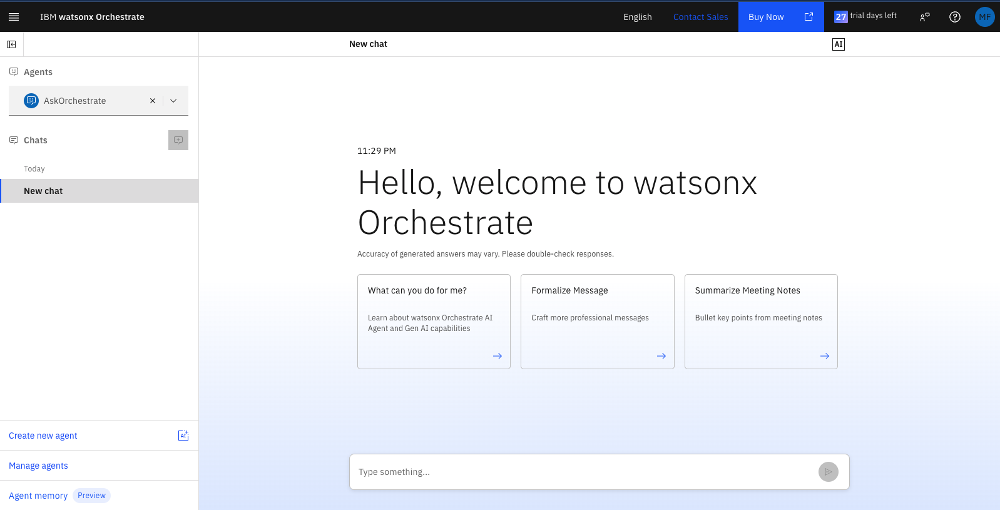
*The watsonx Orchestrate home page after login*

4. Click the **hamburger menu (☰)** at the top left to open the navigation panel
5. Click **Build** in the navigation panel

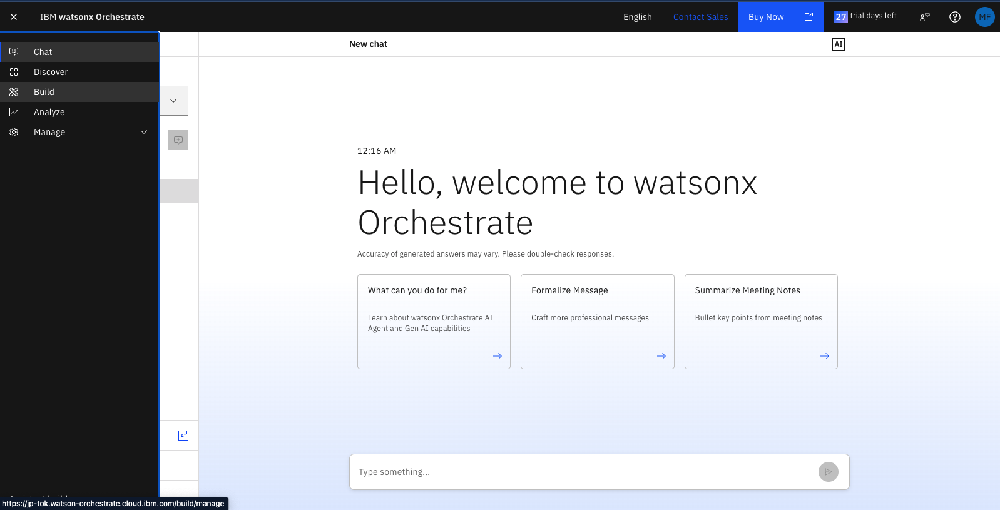
*Navigation panel open — Build option highlighted*

---

## Part 1 — Connect to ServiceNow and Gmail (You Can Skip It)
> **You dont need to do the Part 1 on your own because it is alrady pre-build.**

In watsonx Orchestrate, external services like ServiceNow and Gmail are connected under **Manage → Connections**. You need to configure both connections before building the agent.

---

### Step 1.1 — Open Connections

1. In the navigation panel, click **Manage** to expand it
2. Click **Connections**

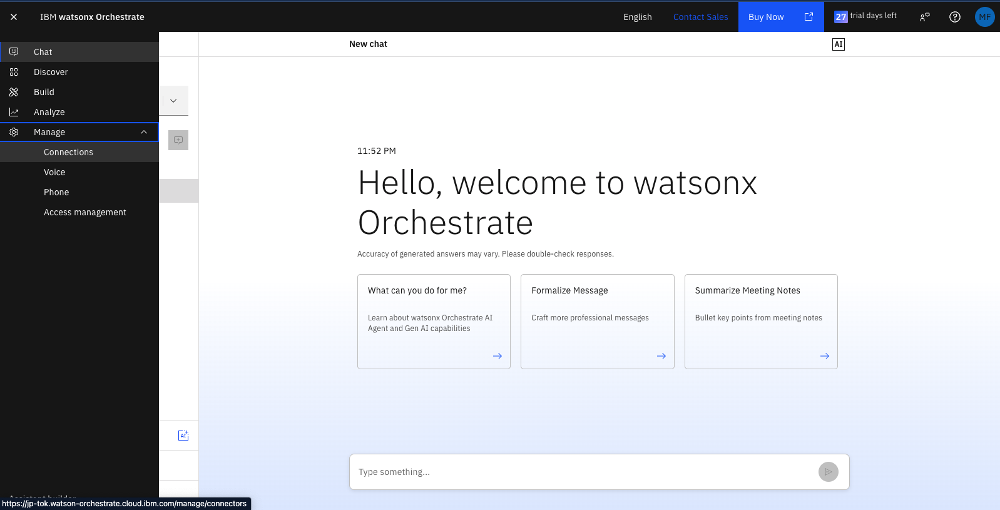
*Navigation panel — Manage expanded, Connections highlighted*

3. On the Connections page, click the **Pre-built** tab

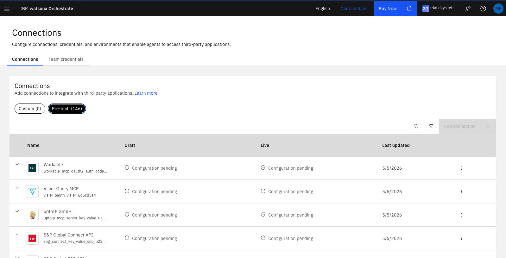
*Connections page with the Pre-built tab selected*

---

### Step 1.2 — Set Up the ServiceNow Connection

1. In the search bar, type `ServiceNow`
2. Click on the **ServiceNow** connection row to open the edit panel

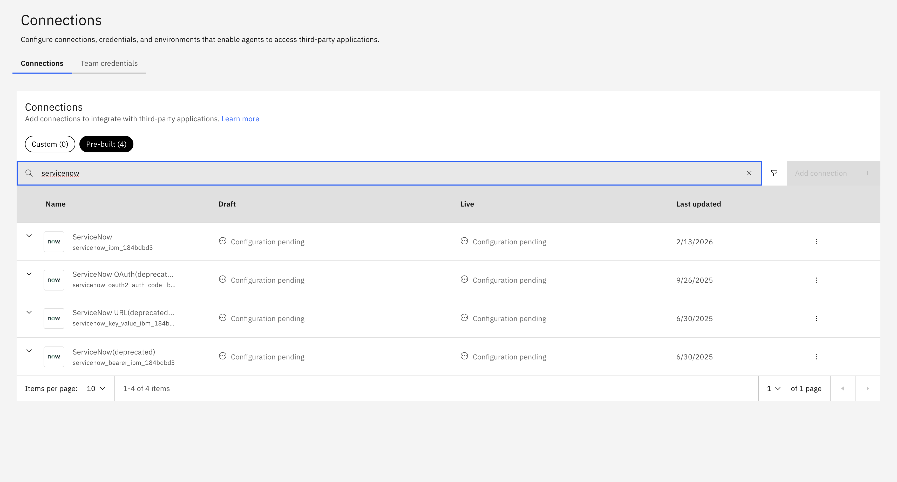
*Connections page — ServiceNow row in the Pre-built list*

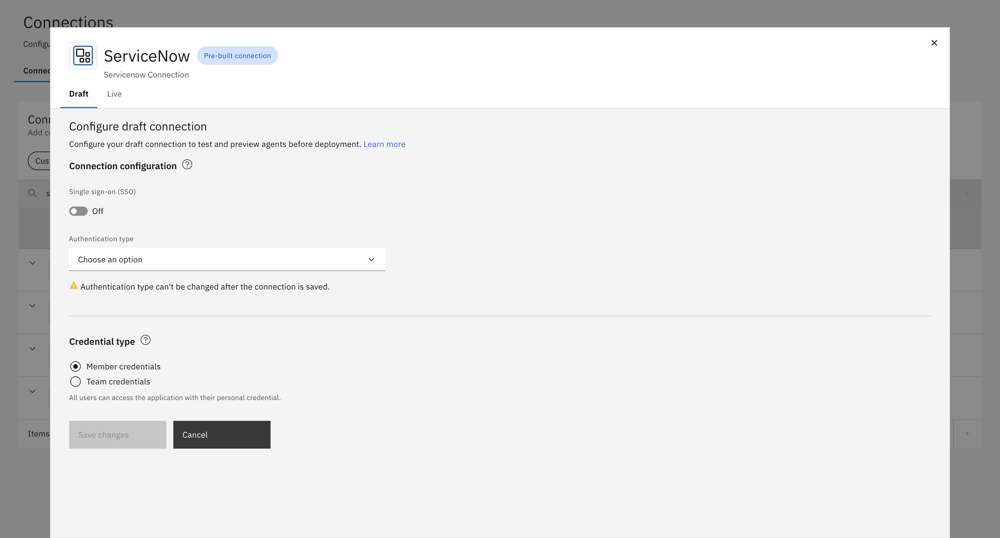
*ServiceNow connection panel — empty, ready to fill in*

3. In the edit panel, click the **Authentication type** dropdown and select **OAuth 2.0 Authorization Code**
4. Fill in the fields below. All values come from your IBM credentials sheet.

   > Replace `devXXXXX` with the actual instance ID from your credentials sheet across all three URL fields.

   | Field | Value |
   |---|---|
   | Server URL | `https://devXXXXX.service-now.com` |
   | Token URL | `https://devXXXXX.service-now.com/oauth_token.do` |
   | Authorization URL | `https://devXXXXX.service-now.com/oauth_auth.do` |
   | Client ID | *(from IBM sheet)* |
   | Client Secret | *(from IBM sheet)* |

5. Under **Credential type**, select **Member credentials**
6. Click **Save changes**

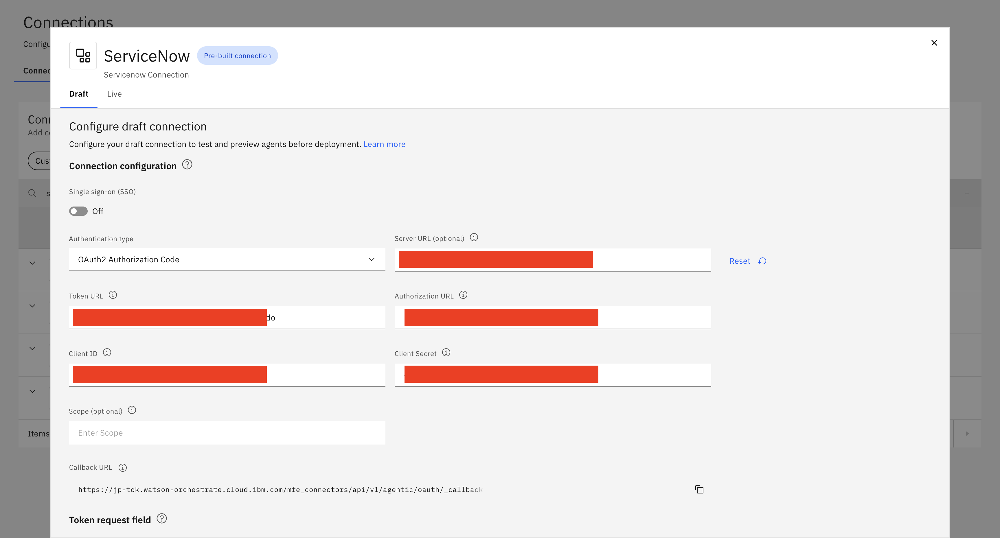
*ServiceNow connection — credentials filled in and saved*

> **Note:** You do not need to click "Connect" here. The authorization will happen automatically in Part 3 when the agent first tries to use ServiceNow.
>
> **Shared instance tip:** If the connection already shows as connected or looks different from the screenshots above, someone else on the team may have already authorized it — just leave it as is and continue.

---

### Step 1.3 — Set Up the Gmail Connection

1. Clear the search bar and type `Google`
2. Click the connection named **Google** (look for the one with ID starting `google_ibm_...`)

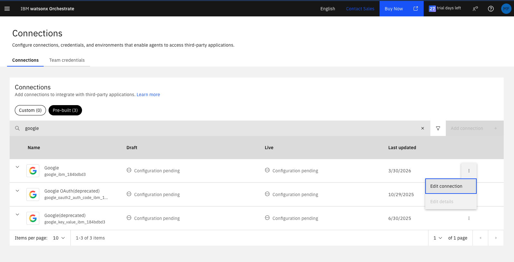
*Search results showing the Google connection row*

3. Click the **Authentication type** dropdown and select **OAuth 2.0 Authorization Code**

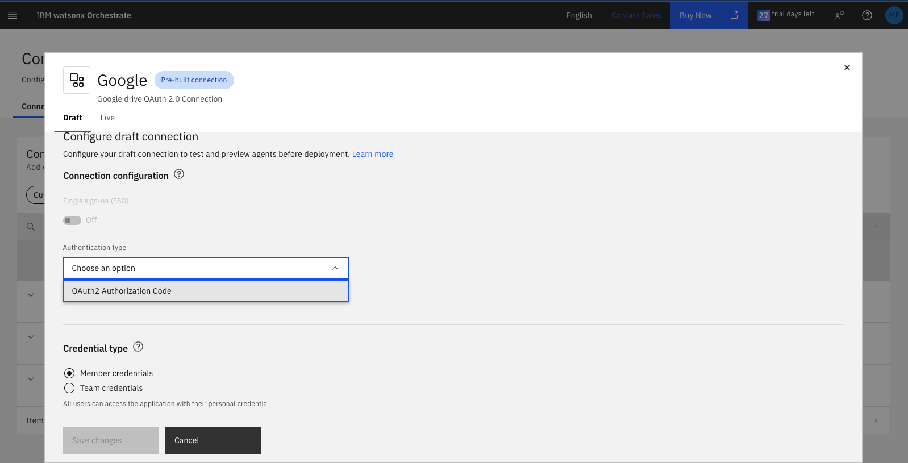
*Authentication type dropdown — OAuth 2.0 Authorization Code selected*

4. The following fields are already pre-filled by WXO — **do not change them:**

   | Field | Pre-filled value |
   |---|---|
   | Server URL | `https://gmail.googleapis.com/` |
   | Token URL | `https://oauth2.googleapis.com/token` |
   | Authorization URL | `https://accounts.google.com/o/oauth2/v2/auth` |
   | Scope | `https://mail.google.com/` |

5. Fill in only these two fields from your IBM credentials sheet:

   | Field | Value |
   |---|---|
   | Client ID | *(from IBM sheet)* |
   | Client Secret | *(from IBM sheet)* |

6. Under **Credential type**, select **Member credentials**
7. Click **Save changes**

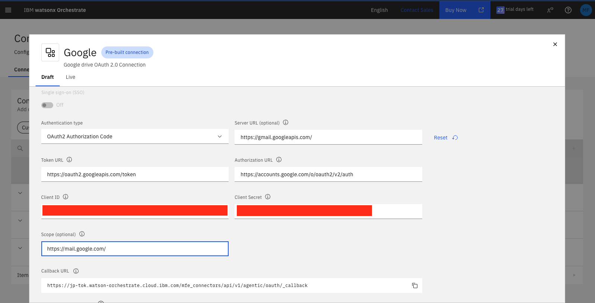
*Google connection panel — Client ID and Client Secret filled in*

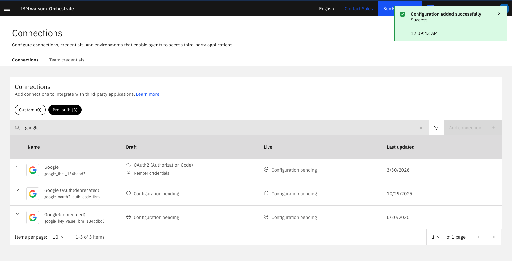
*Green success notification — "Configuration added successfully"*

> **Note:** You do not need to click "Connect" here. The authorization will happen automatically in Part 3 when the agent first tries to use Gmail.
>
> **Shared instance tip:** If the connection already shows as connected or looks different from the screenshots above, someone else on the team may have already authorized it — just leave it as is and continue.

---

> **Checkpoint — Before continuing to Part 2:**
> - ServiceNow connection → saved ✅
> - Gmail connection → saved ✅
>
> If either is missing, go back and complete the setup before building the agent.

---

## Part 2 — Build the Agent with AI

watsonx Orchestrate has a **Build with AI** feature that generates a complete agent from a plain English description. You describe what the agent should do, and WXO configures it automatically — including suggesting the right tools and writing the agent instructions for you.

---

### Step 2.1 — Open Create Agent

1. In the navigation panel, click **Build**
2. Click **Create agent** (button at the top right)

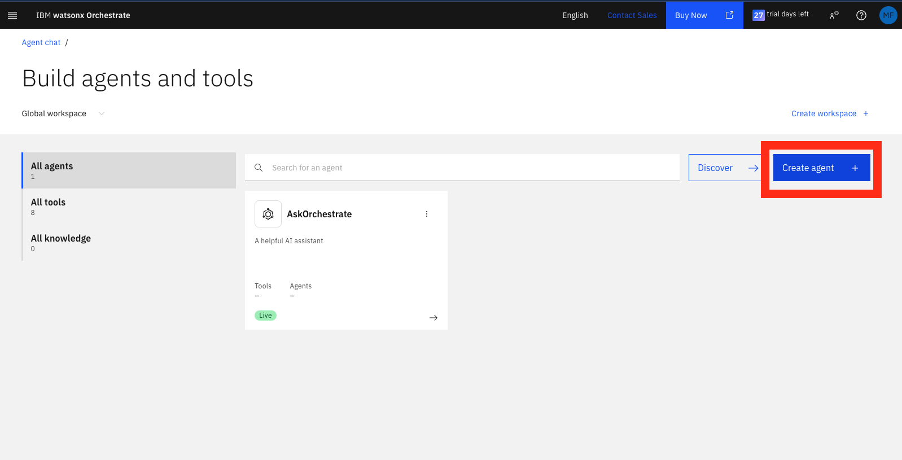
*Build page — Create agent button at the top right*

3. A dialog appears. At the top you will see the **Build with AI** text box.

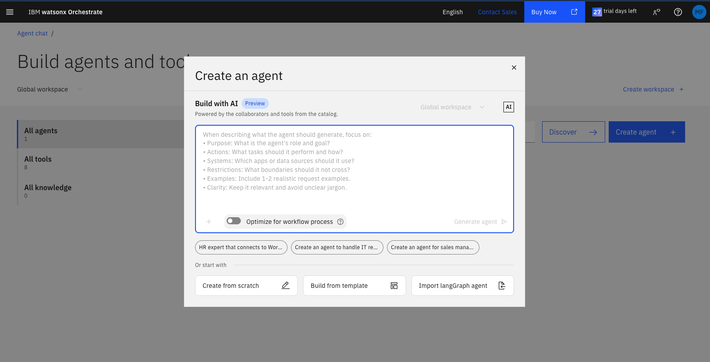
*Create agent dialog — Build with AI text box at the top*

---

### Step 2.2 — Describe the Agent

1. Click inside the **Build with AI** text box and paste the following:

```
Create an IT Support Agent for a service desk team. The agent should list unread emails from Gmail with email: watsonxincubation2@gmail.coma nd create incidents in ServiceNow. It must extract urgency and category from email content, and return a formatted confirmation with the incident number. Never return raw JSON.
```

2. Click the **arrow (→)** button to generate

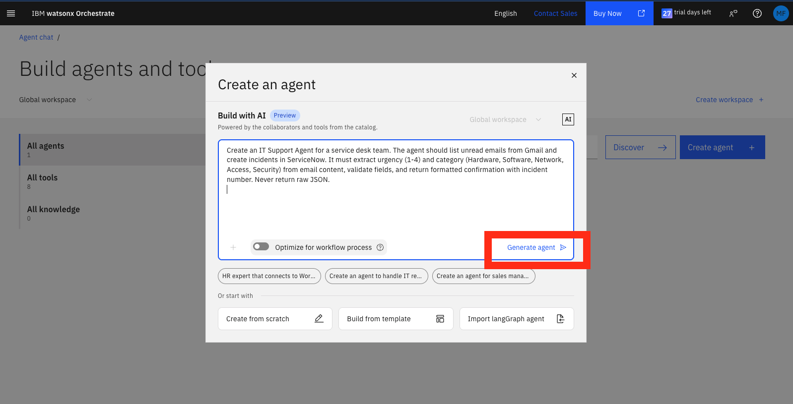
*Build with AI text box — description pasted in, ready to generate*

---

### Step 2.3 — Skip Collaborators

WXO analyzes your description and suggests collaborator agents (Email management and Incident manager). For this lab, we will skip these and use the tools directly instead.

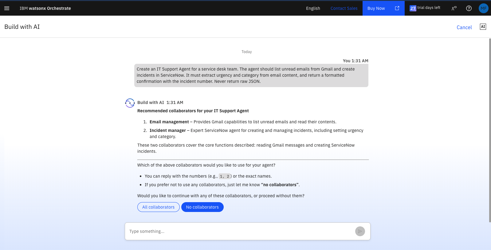
*Build with AI — collaborators suggested, click "No collaborators" to skip*

Click **No collaborators**.

---

### Step 2.4 — Select Tools

WXO will suggest a list of tools. The tools suggested may vary, but look for these two:

- **List emails in Gmail** — to read emails from the service desk inbox
- **Create an incident in ServiceNow** — to open a new incident

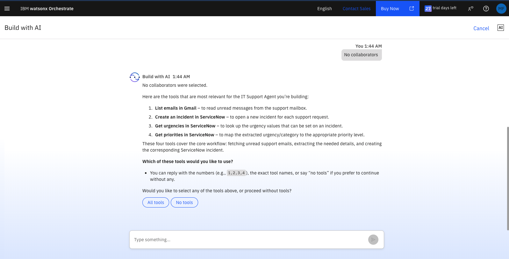
*Build with AI — tool suggestions, select only List emails in Gmail and Create an incident in ServiceNow*

> **Do not click "All tools"** — WXO may suggest additional tools (e.g. Get urgencies in ServiceNow, Get priorities in ServiceNow) that are not needed for this lab.

In the text box, type the exact names of the two tools you need:

```
List emails in Gmail, Create an incident in ServiceNow
```

---

### Step 2.5 — Create the Agent

WXO shows a summary confirming both collaborators and tools are selected.

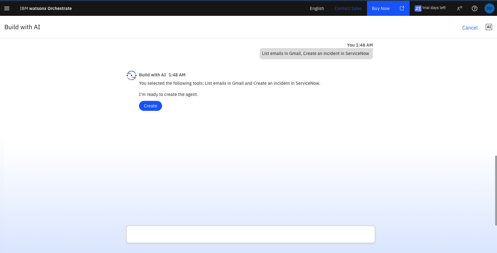
*Build with AI — summary showing collaborators and tools selected, Create button visible*

Click **Create**.

WXO will generate the agent and open the agent page automatically. You will see two things happen at once:
- The agent page opens on the left with the agent profile already filled in
- The **Build with AI** panel on the right confirms a new instruction was added and asks a follow-up question

> **Note:** The agent name is auto-generated by WXO (e.g. `IT_Support_Incident_Creator`). The name may vary — that is fine.

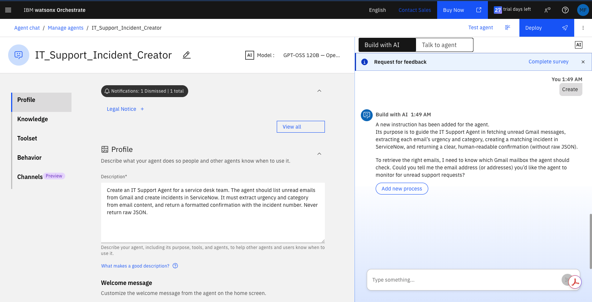
*Agent page — Build with AI confirms instruction added and asks which Gmail mailbox the agent should monitor*

---

### Step 2.6 — Complete the Build with AI Conversation

WXO asks which Gmail mailbox the agent should monitor. For now, just skip this — the agent will use the Gmail account you connected in Part 1.

In the **"Type something..."** input, type:

```
just skip everything first i will tweak it later on
```

Press **Enter**. The Build with AI conversation will end automatically.

> **Note:** You may see an **"Add new process"** button — ignore it and type in the chat input instead.

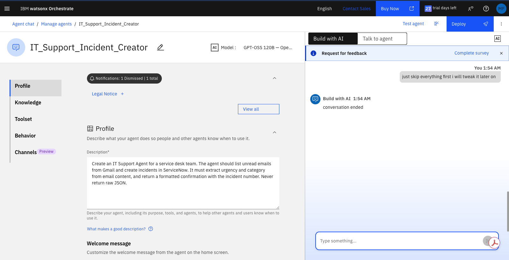
*Build with AI — "conversation ended", agent is ready*

---

### Step 2.7 — Customize Welcome Message and Quick Start Prompts

While still on the agent Profile page, scroll down to update two things before testing.

---

**Welcome message**

Clear the existing welcome message and replace it with:

```
Hi! I'm your IT Support Agent — check emails or create a ServiceNow incident.
```

---

**Quick start prompts**

Delete all three existing prompts by clicking the **trash icon** on each one.

Then click **Add prompt** and add these three one by one:

```
Show me the latest 5 unread emails in the service desk inbox
```

```
Create an incident: a user cannot connect to VPN. High priority.
```

```
I received an email about a laptop not turning on. Create a ServiceNow incident.
```

---

Before making changes, take note of the current state:

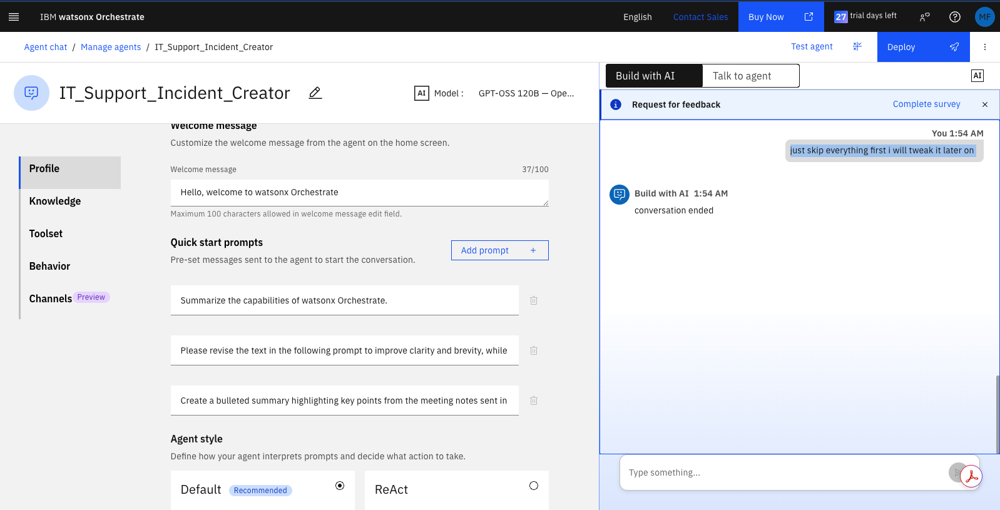
*Agent profile — default welcome message and quick start prompts before customization*

Clear the welcome message and replace it, then delete all existing quick start prompts and add the three new ones above. Click **Save** at the top right when done.

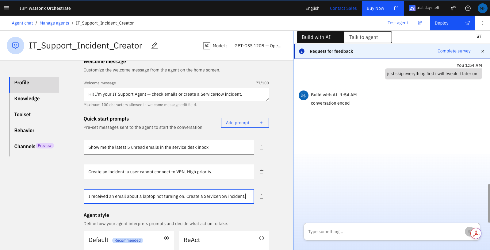
*Agent profile — updated welcome message and quick start prompts after customization*

---

## Part 3 — Test the Agent

By the end of this part, you will have confirmed that **both tools are working** — the Gmail tool by listing real emails, and the ServiceNow tool by creating a real incident.

---

### Step 3.1 — Open the Chat

On the right panel of the agent page, click the **Talk to agent** tab.

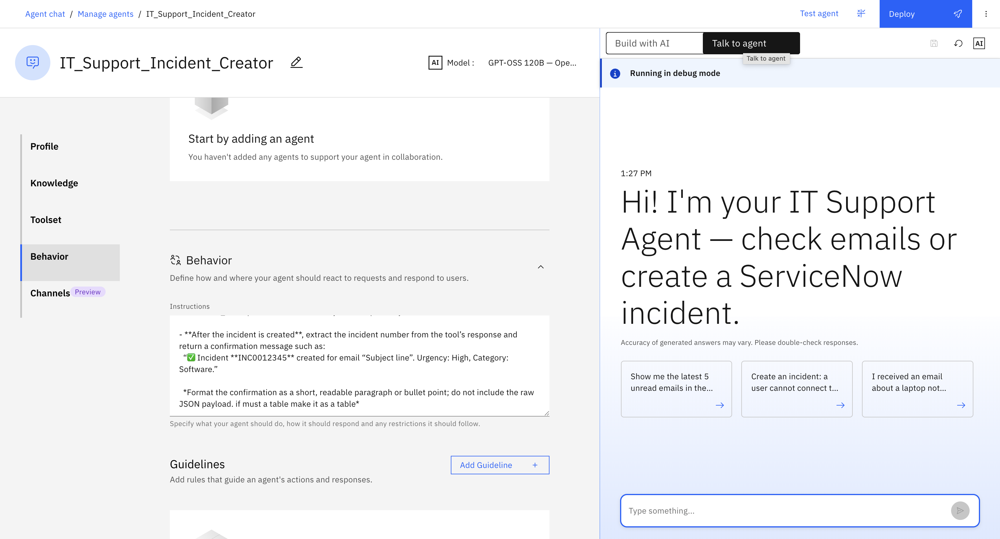
*Agent page — Talk to agent tab selected, chat input ready*

---

### Step 3.2 — Test the Gmail Tool: List Emails

Type the following in the chat:

```
Show me the latest 5 emails in my inbox
```

**First time using Gmail:** A "Connect to app" prompt will appear — this is WXO asking you to authorize the Gmail connection you configured in Step 1.3. But it will be pre-setup in your cases.

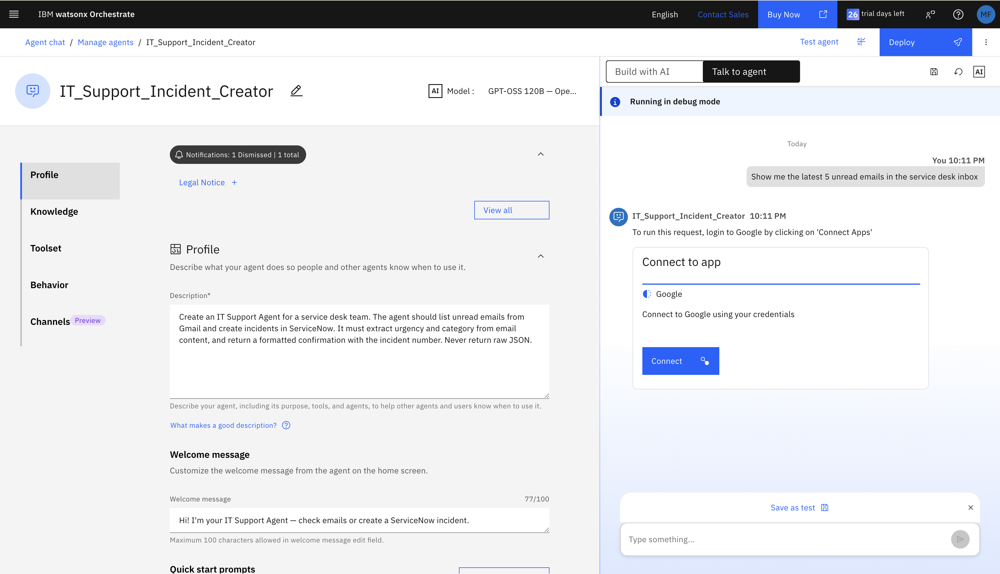
*Chat — "Connect to app" card with Google icon and Connect button*

1. Click **Connect**
2. A Google account picker popup opens — select the service desk Gmail account from your IBM sheet

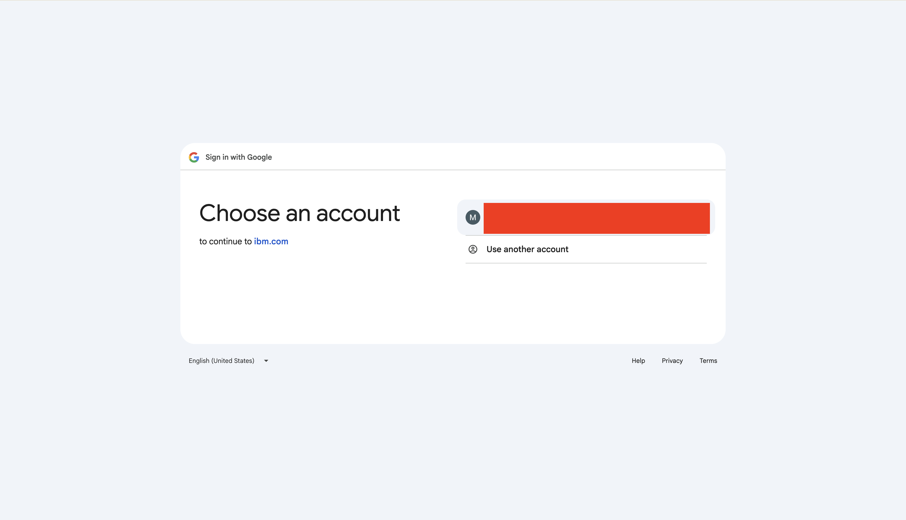
*Google account picker — select the service desk Gmail account*

3. Click **Allow** on the permissions screen
4. The popup closes — the chat shows **"All apps Connected ✅"** confirming Gmail is now authorized

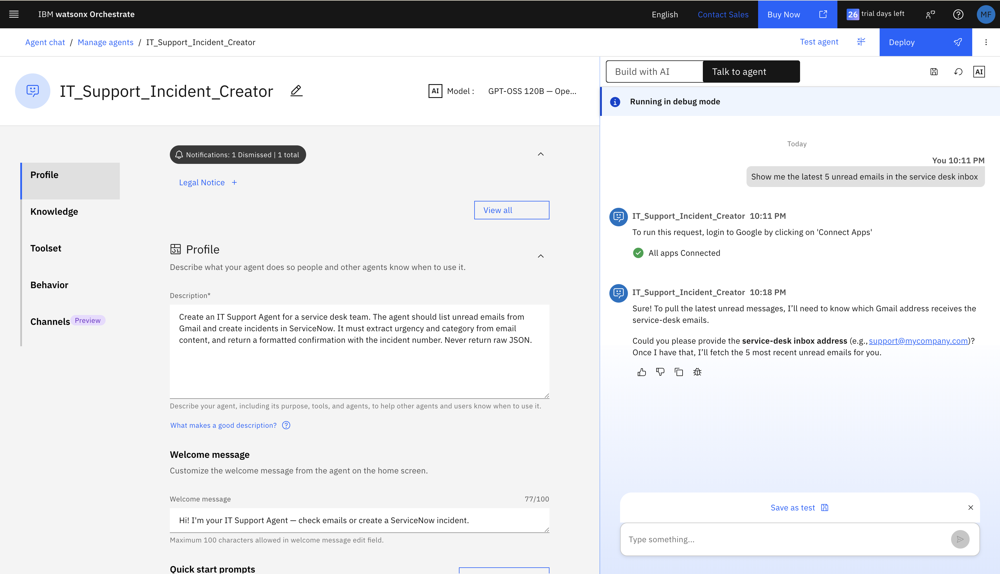
*Chat — "All apps Connected" confirmation after successful Gmail OAuth*

The agent will continue and return a list of emails from the service desk inbox. You should see recent emails with subjects like:
- *"VPN not connecting"*
- *"Outlook keeps crashing"*
- *"Laptop won't turn on"*

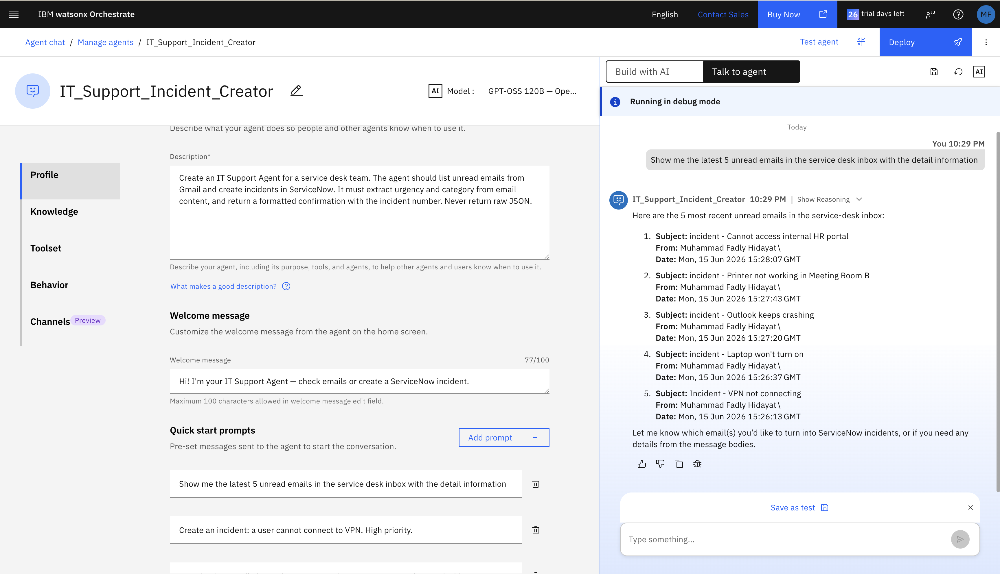
*Chat — agent returns a list of emails from the service desk inbox*

> **Gmail tool: confirmed working ✅**

---

### Step 3.3 — Test the ServiceNow Tool: Create an Incident

Now use one of the email scenarios to create an incident. Type the following:

```
Create a ServiceNow incident for email number 4 — Laptop won't turn on. This is critical.
```

**First time using ServiceNow:** A "Connect to app" prompt will appear in the chat. But it will be pre-setup in your cases

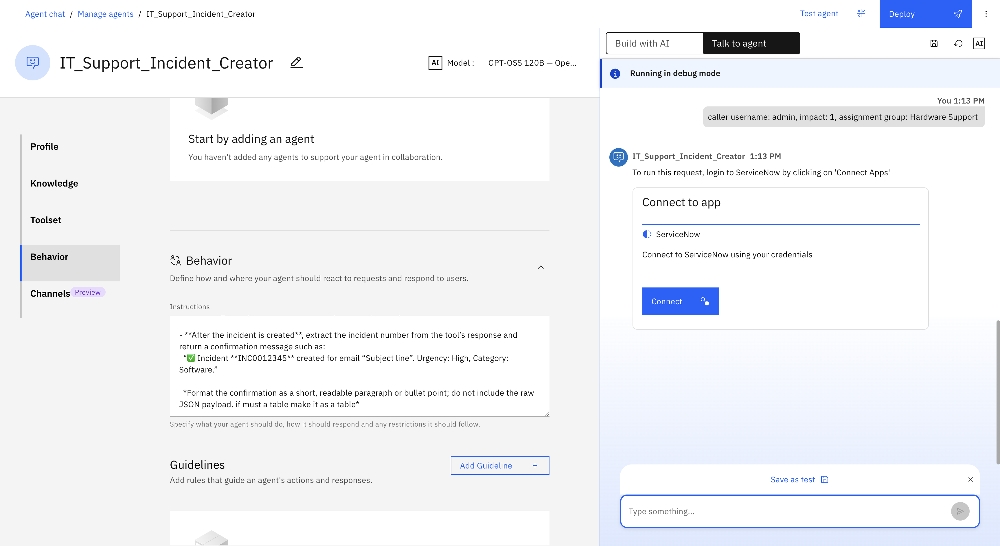
*Chat — "Connect to app" card for ServiceNow*

1. Click **Connect**
2. A ServiceNow login popup opens
3. Sign in with the ServiceNow admin credentials from your IBM sheet
4. Click **Allow**

The agent will analyze the email and may ask for a few additional details before creating the incident — such as caller username, impact level, or assignment group.

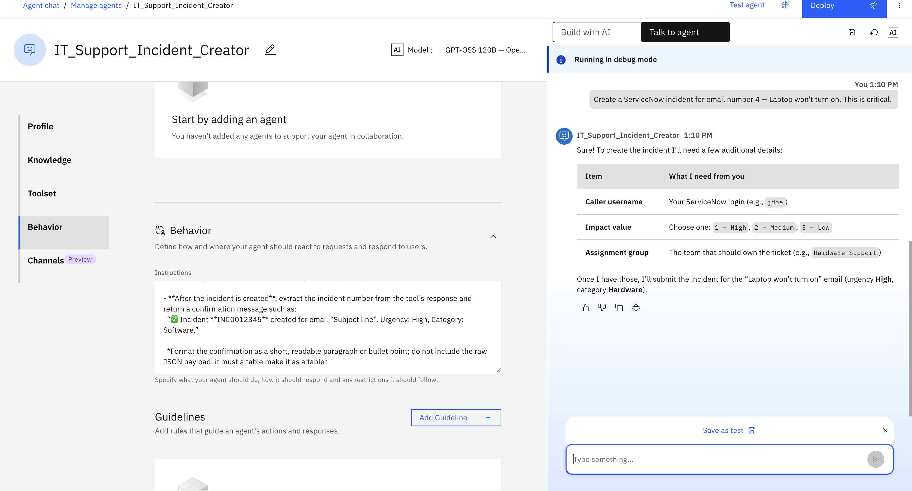
*Agent asking for caller username, impact, and assignment group*

If the agent asks, reply with:

```
caller username: admin, impact: 1, assignment group: Hardware Support
```

The agent will then confirm the incident was created:

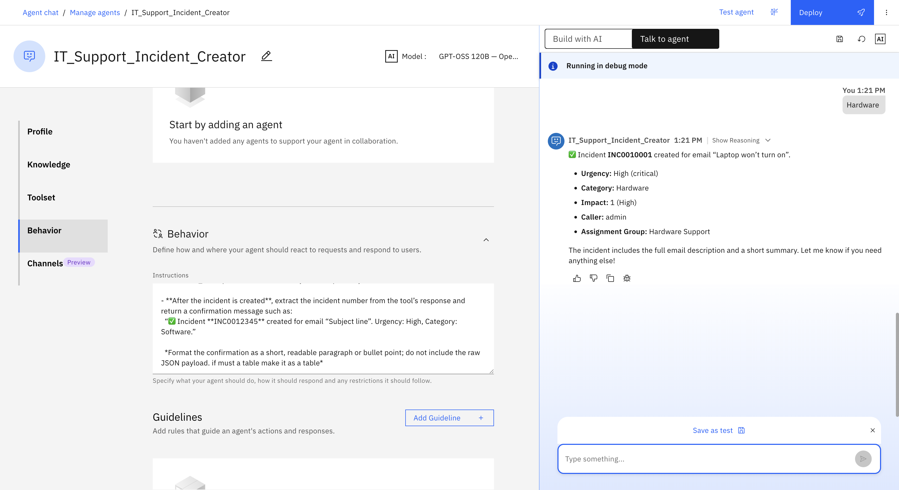
*Chat — incident INC0010001 created successfully*

> **ServiceNow tool: confirmed working ✅**

> **Shared instance tip:** If the agent does not ask for additional details and creates the incident directly — that is also fine. The agent behaviour may vary slightly.

---

### Step 3.4 — Verify in ServiceNow

Open the ServiceNow instance URL from your IBM sheet in a new browser tab.

1. Log in with the admin credentials
2. Navigate to **Incident → All**
3. Find the incident your agent just created — confirm the category is **Hardware**

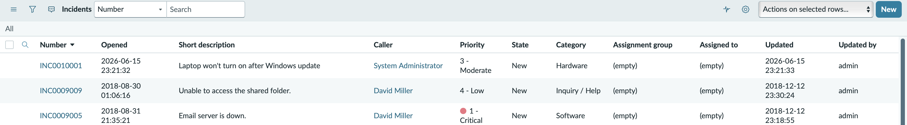
*ServiceNow — INC0010001 visible in the incident list*

Both tools are now confirmed working end-to-end.

---

## Summary

| Part | What you did | Outcome |
|---|---|---|
| 1 | Configured ServiceNow and Gmail connections under Manage → Connections | Both services ready to be used by agents |
| 2 | Used Build with AI to generate IT_Support_Desk_Agent | Agent configured with Gmail and ServiceNow tools |
| 3 | Tested the agent in chat and authorized both connections | Live emails listed, live incident created in ServiceNow |

---

## Image Reference Index

| # | File | Status | Step |
|---|---|---|---|
| 01 | `01-wxo-home-dashboard.png` | ✅ | WXO home page after login |
| 02 | `02-wxo-build-mode.png` | ✅ | Navigation panel — Build selected |
| 03 | `03-wxo-manage-connections.png` | ✅ | Manage → Connections |
| 04 | `04-wxo-connections-prebuilt.png` | ✅ | Connections page — Pre-built tab |
| 05 | `05-wxo-connections-servicenow.png` | ✅ | ServiceNow connection row |
| 06 | `06-wxo-servicenow-credentials.png` | ✅ | ServiceNow connection panel — empty |
| 07 | `07-wxo-servicenow-credentials-filled.png` | ✅ | ServiceNow credentials filled in |
| 08 | `08-wxo-connections-google.png` | ✅ | Google connection row |
| 09 | `09-wxo-google-auth-type.png` | ✅ | Gmail auth type — OAuth 2.0 selected |
| 10 | `10-wxo-google-credentials.png` | ✅ | Gmail Client ID and Secret filled in |
| 11 | `11-wxo-google-saved.png` | ✅ | Gmail saved — success notification |
| 12 | `12-wxo-create-agent.png` | ✅ | Build page — Create agent button |
| 13 | `13-wxo-create-agent-dialog.png` | ✅ | Create agent dialog — Build with AI |
| 14 | `14-wxo-build-with-ai-filled.png` | ✅ | Build with AI — description entered |
| 15 | `15-wxo-collaborators-suggested.png` | ✅ | Build with AI — collaborators suggested |
| 16 | `16-wxo-tools-suggested.png` | ✅ | Build with AI — tools suggested |
| 17 | `17-wxo-ready-to-create.png` | ✅ | Build with AI — ready to create |
| 18 | `18-wxo-agent-created.png` | ✅ | Agent page — Build with AI follow-up question |
| 19 | `19-wxo-conversation-ended.png` | ✅ | Build with AI — conversation ended |
| 20 | `20-wxo-agent-profile-original.png` | ✅ | Agent profile — original welcome message and prompts |
| 21 | `21-wxo-agent-profile-updated.png` | ✅ | Agent profile — updated welcome message and prompts |
| 22 | `22-wxo-talk-to-agent.png` | ✅ | Agent page — Talk to agent tab |
| 23 | `23-wxo-connect-to-app.png` | ✅ | Chat — Connect to app prompt (Google) |
| 24 | `24-wxo-google-choose-account.png` | ✅ | Google account picker |
| 25 | `25-wxo-all-apps-connected.png` | ✅ | Chat — "All apps Connected" success confirmation |
| 26 | `26-wxo-test-list-emails.png` | ✅ | Chat — email list result |
| 27 | `27-wxo-servicenow-agent-ask-details.png` | ✅ | Chat — agent asking for additional incident details |
| 28 | `28-wxo-servicenow-connect-to-app.png` | ✅ | Chat — Connect to app prompt (ServiceNow) |
| 29 | `29-wxo-test-create-incident.png` | ✅ | Chat — incident INC0010001 created confirmation |
| 30 | `30-servicenow-verify.png` | ✅ | ServiceNow — incident visible in list |

---

## Troubleshooting

**"Connect to app" does not appear when I send a message**  
Refresh the agent page and send the message again. Make sure credentials were saved in Manage → Connections before running the agent.

**Google sign-in popup shows "Access blocked: redirect_uri_mismatch"**  
Contact the IBM facilitator — the redirect URI in the Google Cloud OAuth setup needs to be corrected.

**ServiceNow popup opens but then shows a blank page or times out**  
Open the ServiceNow URL in a separate browser tab first to wake the instance, then return to WXO and send the message again.

**Agent responds but email list is empty**  
The shared Gmail inbox should already have test emails loaded. If it is empty, inform the IBM facilitator.

**Build with AI suggests different tools or asks different questions**  
That is normal — WXO's suggestions can vary slightly. Accept whatever is suggested and continue. The agent will still have access to Gmail and ServiceNow.

---

## Next Step

Proceed to **Lab 2**.
