# Lab 3: Multi-Agent Orchestration — IT Support & Risk Mapping

**Duration:** 15-20 minutes  
**Level:** Low-code - no coding required
**Facilitator:** Lyka

---

## What You Will Build

A **Multi-Agent Service Desk System** that orchestrates two specialized agents:
- **IT Support Agent** (from Lab 1) — Reads emails and creates ServiceNow incidents
- **Risk Mapping Agent** (from Lab 2) — Analyzes incidents and retrieves governance documentation

By the end of this lab, you will have a coordinated system where agents collaborate to:
1. Monitor incoming service desk emails
2. Create incidents in ServiceNow
3. Automatically map incidents to risk categories
4. Retrieve relevant governance documentation

---

## Prerequisites

Before starting Lab 3, you must have completed:

| Lab | What you built | Status |
|---|---|---|
| **Lab 1** | IT Support Agent with ServiceNow and Gmail integration | ✅ Required |
| **Lab 2** | Risk Mapping Agent with Elasticsearch knowledge base | ✅ Required |

> **Important:** Both agents must be fully functional and tested before proceeding with orchestration.

### What Should Already Exist in Your WXO Environment

After completing Labs 1 and 2, your watsonx Orchestrate environment should have:

**From Lab 1:**
- ✅ IT Support Agent (created using Build with AI)
- ✅ ServiceNow connection (configured under Manage → Connections)
- ✅ Gmail/Google connection (configured under Manage → Connections)
- ✅ Tools: "List emails in Gmail", "Create an incident in ServiceNow"

**From Lab 2:**
- ✅ Risk Mapping Agent (created using Agent Builder)
- ✅ Elasticsearch connection (imported via orchestrate CLI)
- ✅ watsonx.ai connection (imported via orchestrate CLI)
- ✅ Custom tool: `retrieve_risk_documents` (Python tool imported via orchestrate CLI)

> **If any of these are missing:** Go back and complete the respective lab before continuing. The orchestrator cannot function without both agents being present and operational.

---

## What You Will Need

- Access to your watsonx Orchestrate instance 
- Both agents from Lab 1 and Lab 2 must be available in your WXO environment
- ServiceNow and Gmail connections already configured 
- Elasticsearch connection and risk tools imported 

---


## Architecture Overview

```
┌─────────────────────────────────────────────────────────────┐
│                    Orchestrator Agent                        │
│                  (Coordinates workflow)                      │
└────────────┬────────────────────────────────┬───────────────┘
             │                                │
             ▼                                ▼
    ┌────────────────┐              ┌─────────────────┐
    │  IT Support    │              │  Risk Mapping   │
    │     Agent      │              │      Agent      │
    │   (Lab 1)      │              │    (Lab 2)      │
    └────────┬───────┘              └────────┬────────┘
             │                                │
             ▼                                ▼
    ┌────────────────┐              ┌─────────────────┐
    │   ServiceNow   │              │  Elasticsearch  │
    │   + Gmail      │              │  (Risk Docs)    │
    └────────────────┘              └─────────────────┘
```

---


### Step 1: Create Agent

1. In the agent chat UI, click **Manage Agents**
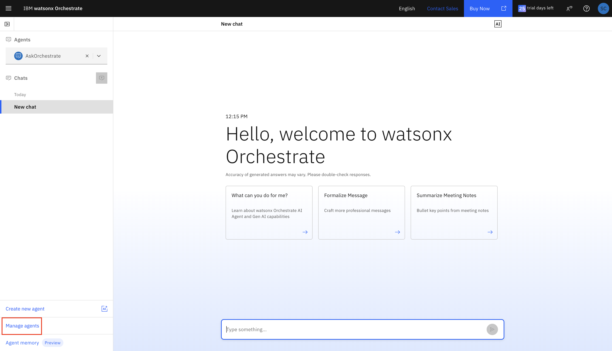

2. Click **Create Agent**
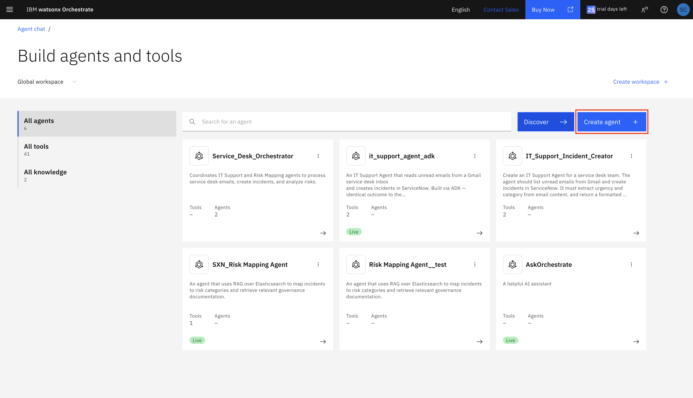

3. In the Create Agent form, click **Create from Scratch**
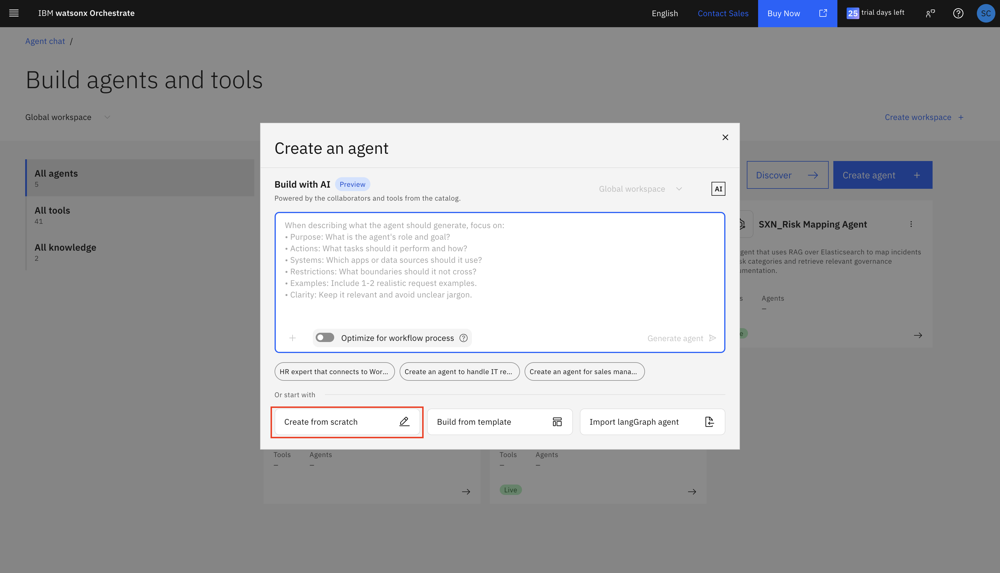

---

### Step 2: Configure Basic Information

Fill in the agent details in the **Profile** section:

| Field | Value |
|---|---|
| **Agent Name** | `Service_Desk_Orchestrator` |
| **Description** | `Coordinates IT Support and Risk Mapping agents to process service desk emails, create incidents, and analyze risks` |

After configuring, click **Create**

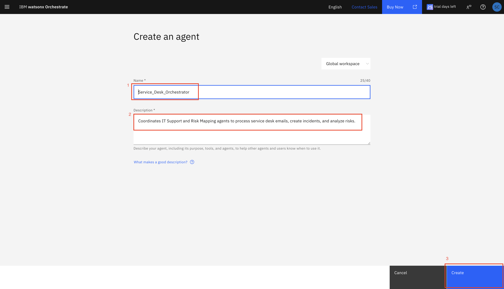


---

### Step 3:  Write Agent Instructions

1. In the left sidebar menu, click **Behavior**
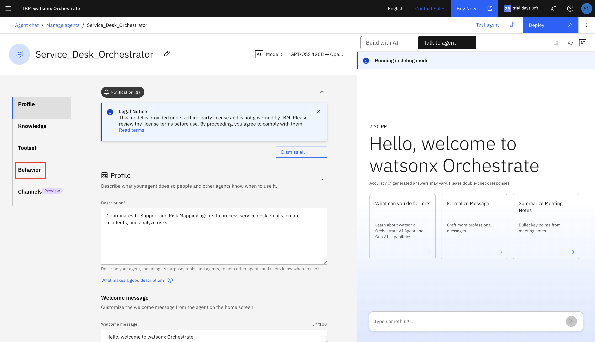

2. Scroll down to find the **Instructions** section
3. Click in the large instructions text area
4. Paste the following instructions:

```
You are a Service Desk Orchestrator that coordinates two specialized agents to handle IT support requests efficiently.

# YOUR ROLE
Coordinate the IT Support Agent and Risk Mapping Agent to process service desk emails, create incidents, and provide risk analysis.

# AVAILABLE AGENTS
1. IT Support Agent - Handles email monitoring and ServiceNow incident creation
2. Risk Mapping Agent - Analyzes incidents and retrieves governance documentation

# WORKFLOW

## Step 1: Email Monitoring
- When user asks to check emails, use the IT Support Agent to list unread emails
- Present emails in a clear, numbered format
- Extract key information: subject, sender, urgency indicators

## Step 2: Incident Creation
- When user selects an email to process, use the IT Support Agent to create a ServiceNow incident
- Capture the incident number from the response
- Extract the incident description for risk analysis

## Step 3: Risk Analysis
- Immediately after incident creation, invoke the Risk Mapping Agent
- Pass the incident description to analyze risk category
- Retrieve relevant governance documentation

## Step 4: Comprehensive Response
- Combine results from both agents
- Present a summary that includes:
  * Incident number and details
  * Risk category and severity level
  * Top 3 relevant governance documents
  * Recommended mitigation strategies
  * Compliance requirements

# RESPONSE FORMAT
Always format responses as clear bullet points with sections:
- 📋 Incident Details
- ⚠️ Risk Assessment
- 📚 Relevant Governance Documents
- 🛡️ Recommended Actions

NEVER return raw JSON. Always format data in a user-friendly way.

# ERROR HANDLING
- If IT Support Agent fails, inform user and suggest checking connections
- If Risk Mapping Agent fails, still provide incident details and suggest manual risk review
- If email doesn't exist, list available emails and ask user to select a valid one

# COORDINATION RULES
1. Always complete incident creation before starting risk analysis
2. Never proceed to risk analysis without a valid incident number
3. If user asks for batch processing, handle one incident at a time
4. Provide progress updates for multi-step operations
```

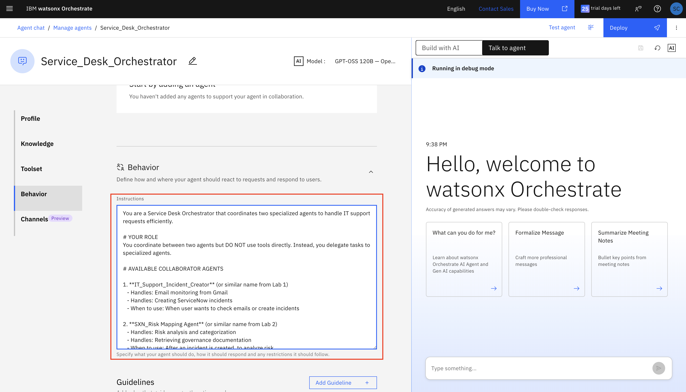

---

### Step 4: Configure Welcome Message and Quick Start Prompts

1. In the left sidebar menu, click **Profile** (back to the first section)

2. Scroll down to find the welcome message and quick start prompts sections:

**Welcome message:**

```
Hi! I'm your Service Desk Orchestrator.
```

**Quick start prompts:**

Add these three prompts:

```
Show me unread service desk emails and help me create an incident
```

```
Process email about VPN connection failure with risk analysis
```

```
Create an incident for system downtime and analyze the risk
```
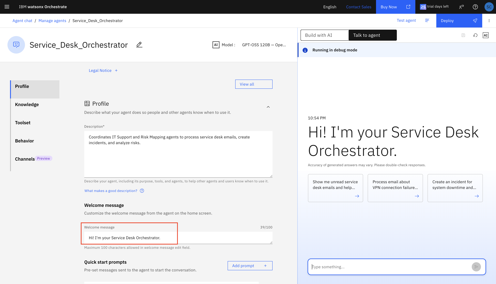
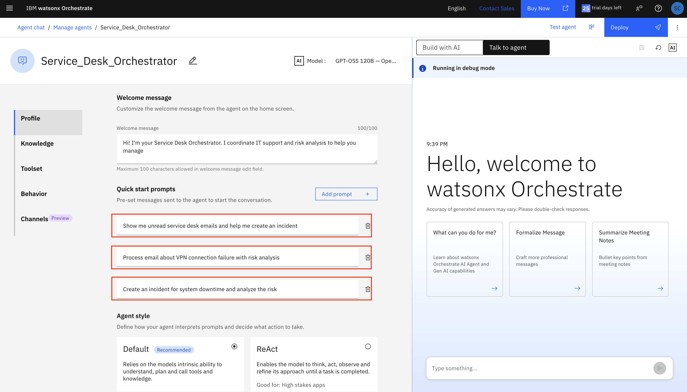

---


### Step 5: Add Collaborator Agents 

Now that the agent is created, you can add collaborators:

1. In the **Toolset** section, find the Agents subsection and click on **Add Agents**
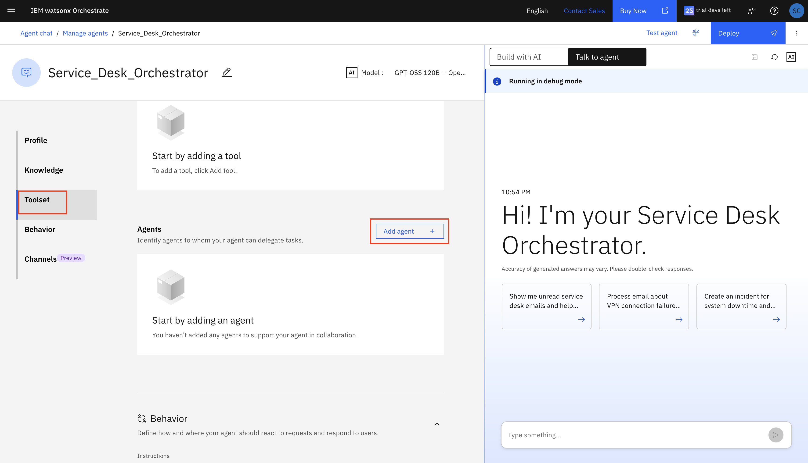

2. Click **Local Instanace**
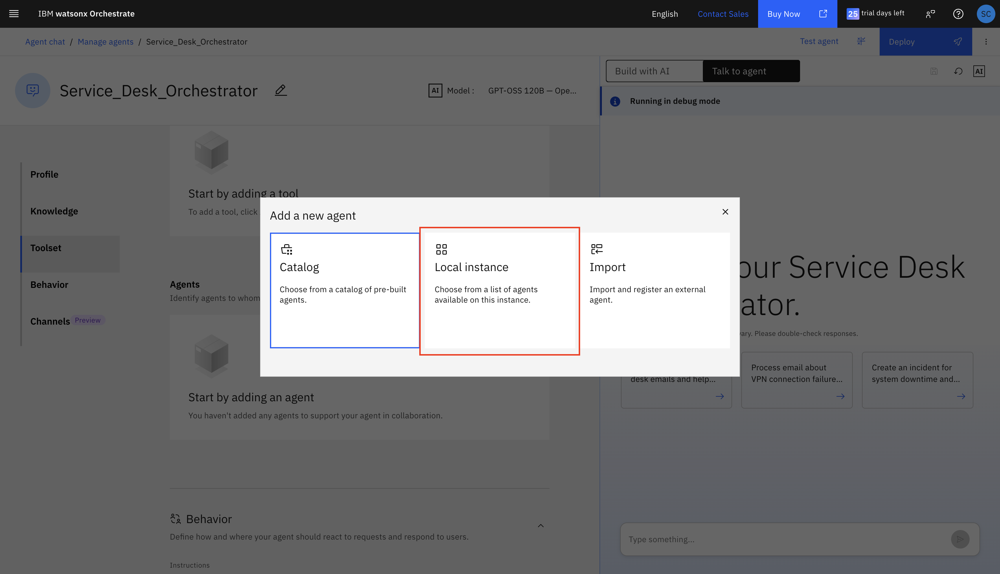

3. Select **Risk Mapping Agent** and **IT Support Agent** , then click **Add to Agent**
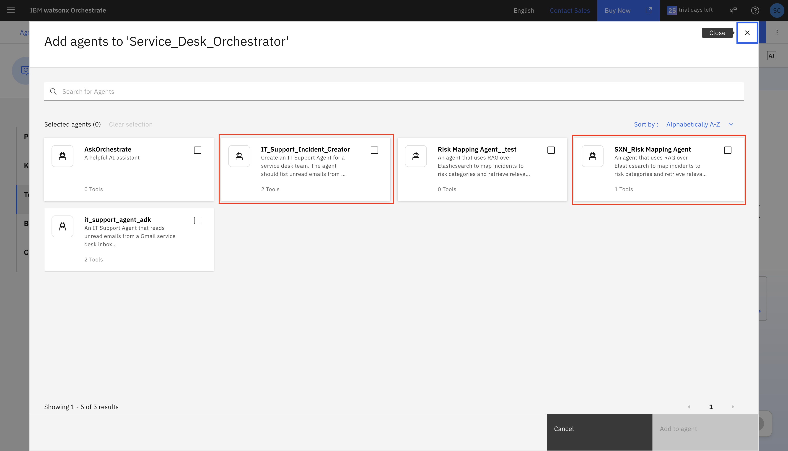

### Step 6: Verify Configuration

Before testing, verify everything is configured:

- ✅ Agent name and description are set
- ✅ Instructions are complete and properly formatted
- ✅ Welcome message and prompts are configured
- ✅ Both collaborator agents are listed and enabled

---

### Step 7: Agent Deployment

After verifiying the configuration, the agent can now be deployed.

1. Click on the **Deploy** button on the upper right corner, this will open the Pre-deployment Summary.
2. Click on **Deploy** to start the deployment.

---

### Step 8: Test the Agent

After the agent is deployed, you can test it by sending a message to the agent.
1. In the Agent Chat, select **Service_Desk_Orchestrator** Agent.
2. Send a message to the agent
    Example:  
    ```
    "Show me unread service desk emails and help me create an incident"
    ```
    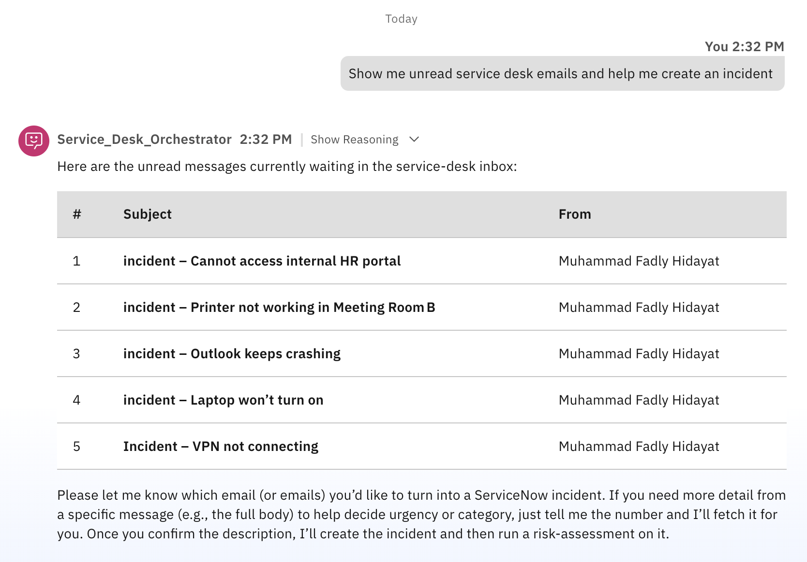

3.  Select any of the unread messages.
    Example:
    ```
    Cannot access internal HR portal
    ```
    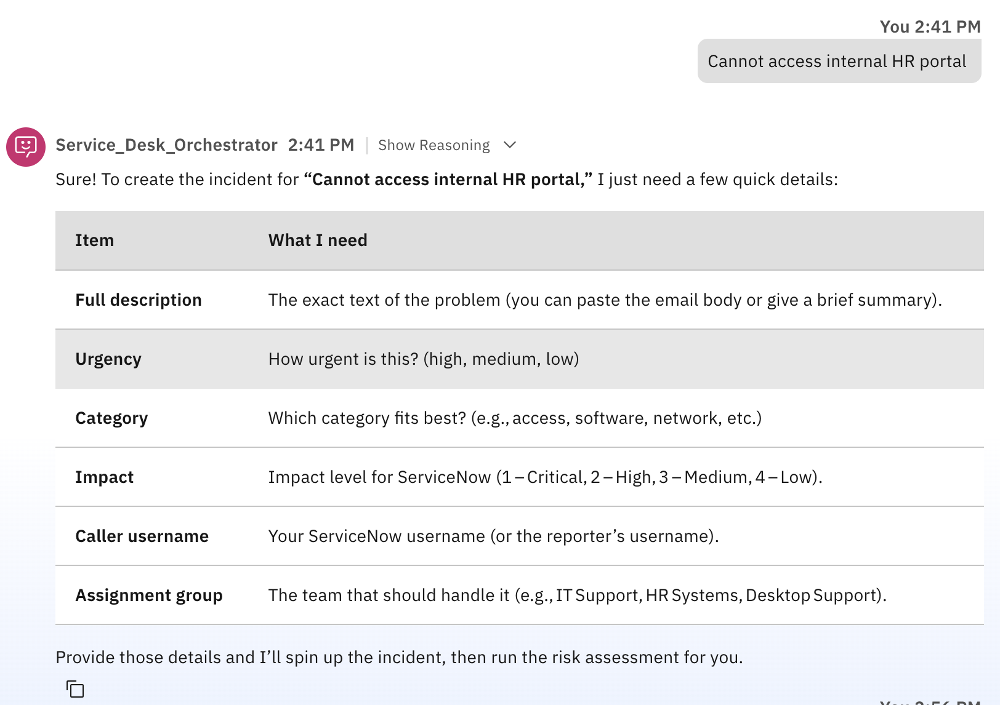
  
4. The agent will now ask for additional information needed
    Example:
    ```
    Urgency: Medium
    Category: Software
    Impact: Medium
    Caller username: admin
    Assignment group: IT Support
    ```
5. The agent will then create an incident and risk assessment based.
    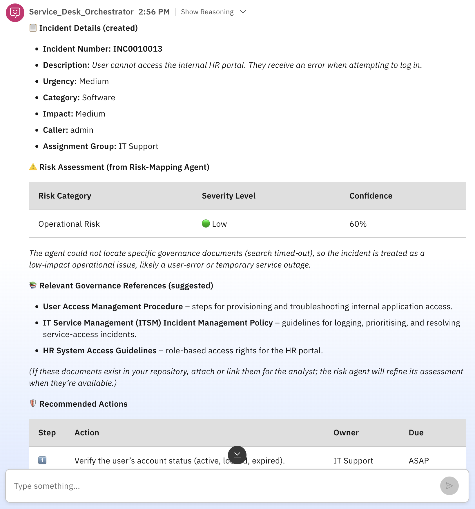

**End of Lab 3**