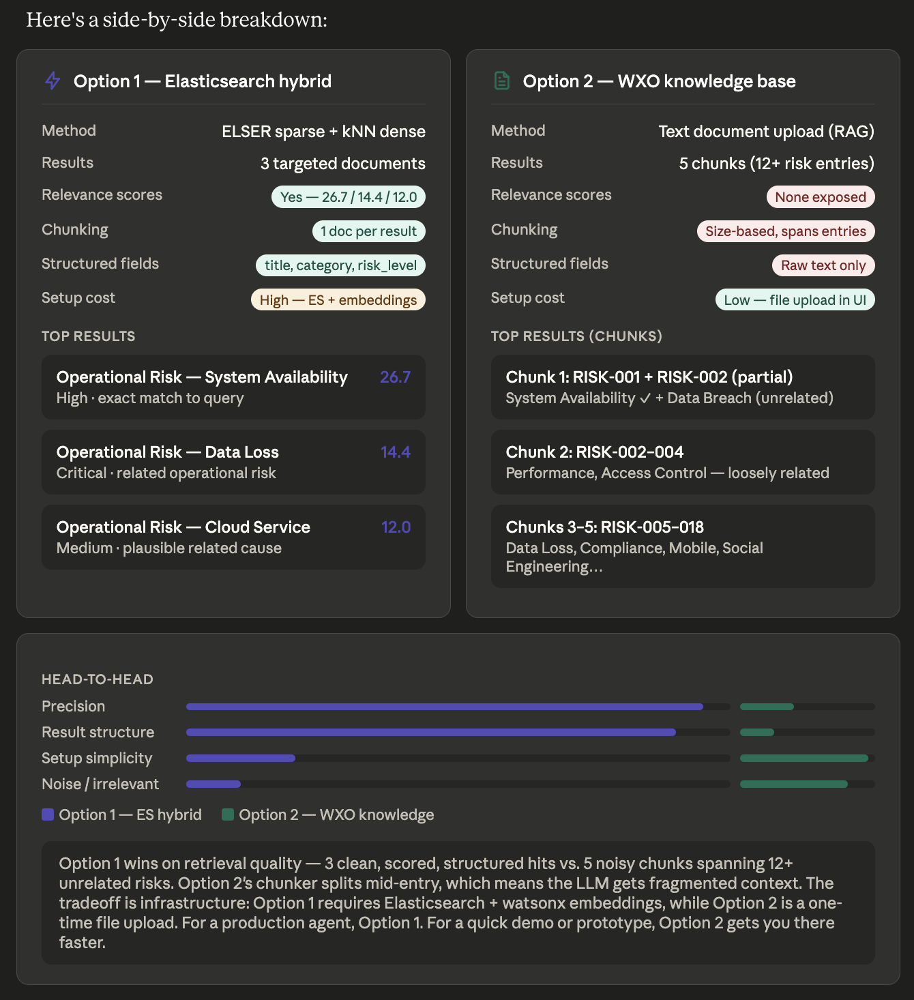
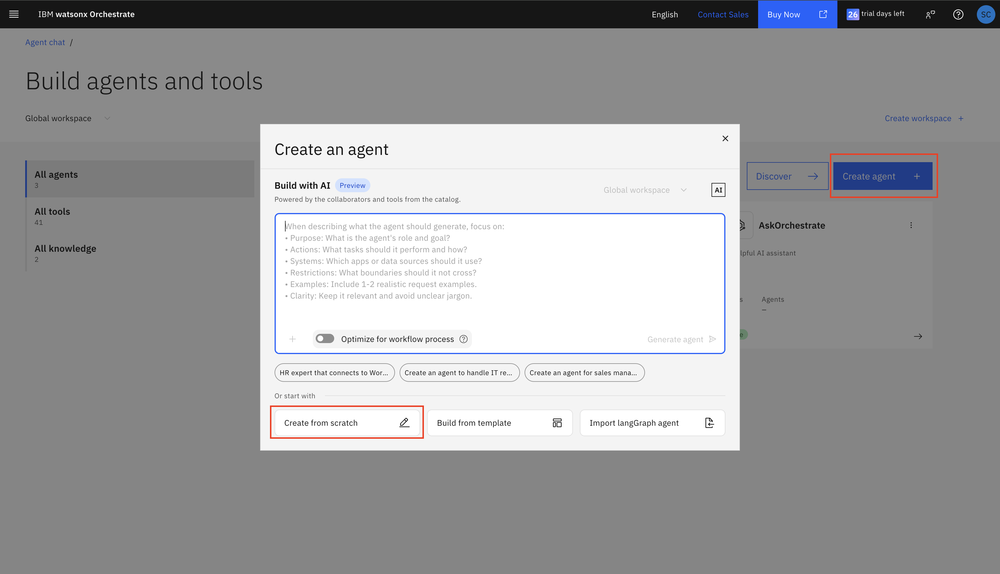
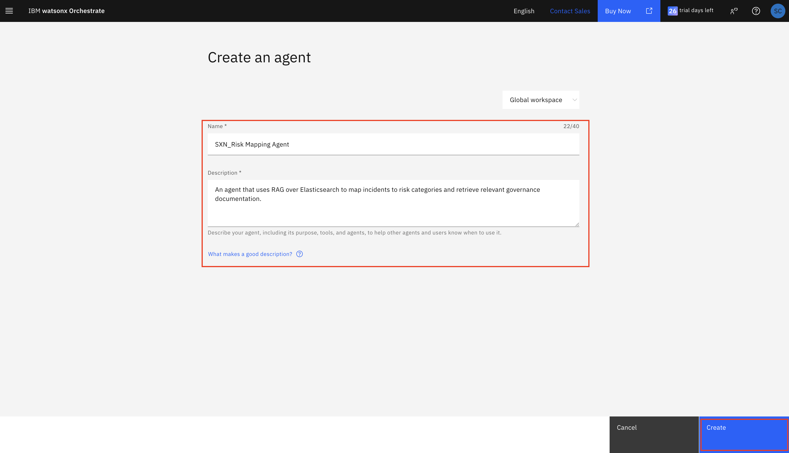
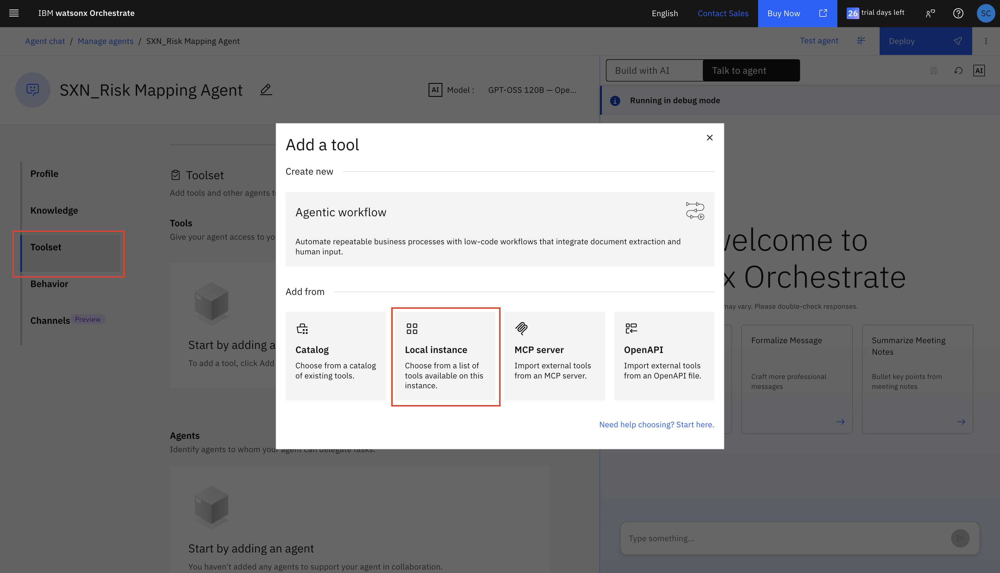
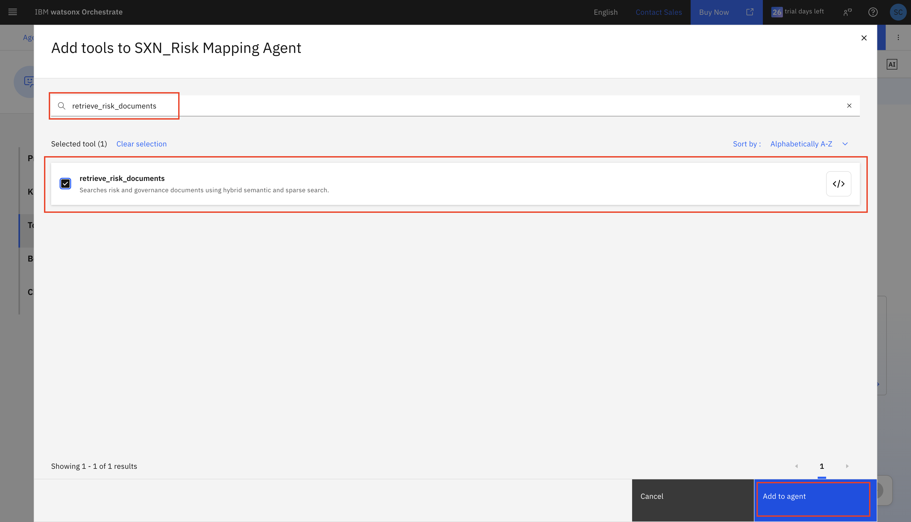
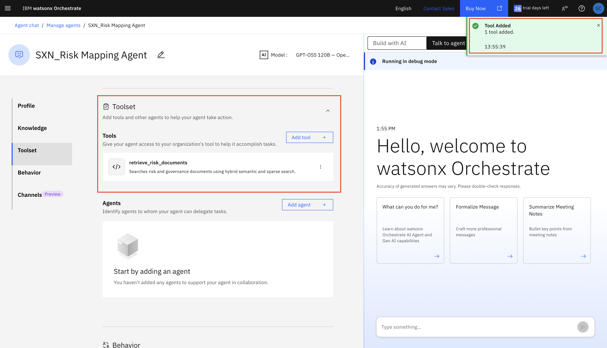
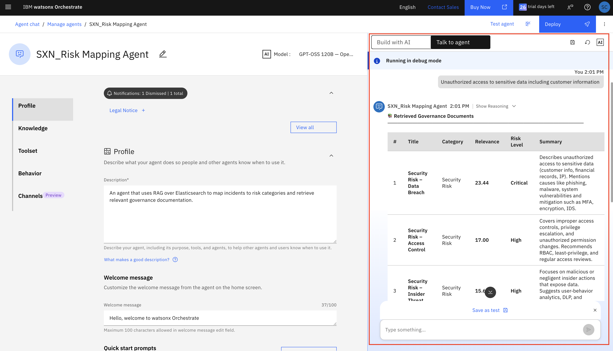
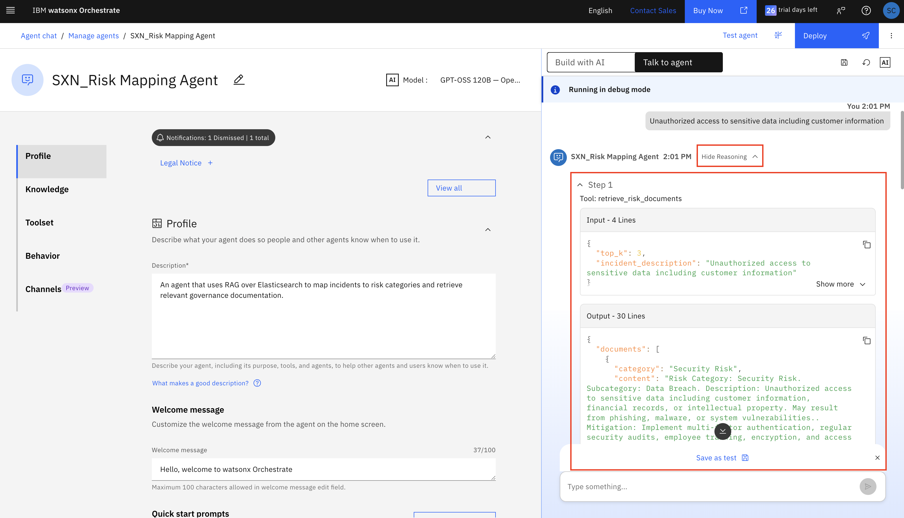
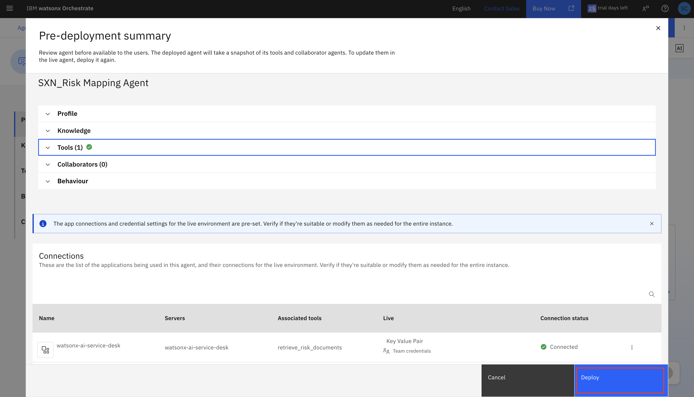
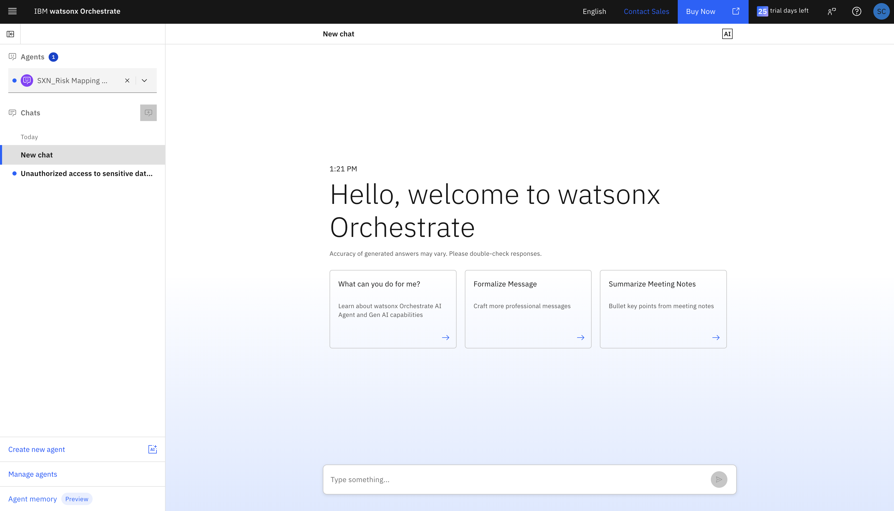

# Elasticsearch Agent — Complete INSTRUCTOR Implementation Guide

> **AI-Powered Service Desk Automation with Watsonx Discovery (Elasticsearch. An agent that uses RAG over Elasticsearch to map incidents to risk categories and retrieve relevant governance documentation)**
> 
> **Stack:** watsonx Orchestrate, watsonx Discovery (Elasticsearch)
> **Approach:** Agent Builder with Tools

---

## 1. Environment Setup

### 1.1 Environment Variables

The instructor will provide the credentials.

Create `.env` file at project root with the following variables:

```ini
# Elasticsearch (Knowledge Base)
ES_HOST=your-elasticsearch-host.com    # No https:// prefix
ES_PORT=9200
ES_USERNAME=elastic
ES_PASSWORD=your_password
ES_CERT_CONTENT="-----BEGIN CERTIFICATE----- ....... -----END CERTIFICATE-----"
ES_CERT_PATH=./certs/ca.crt # optional
ES_USE_SSL=true
ES_VERIFY_CERTS=false                  # false for dev/testing

RISK_MAPPING_INDEX="risk_mapping_hybrid_index"

# IBM Watsonx Orchestrate
WATSONX_ORCHESTRATE_URL=https://your-instance.ibm.com
WXO_APIKEY=your_api_key
WXO_ENV_NAME=landbank_service_desk_assistant_<num>

# ── IBM watsonx.ai ─────────────────────────────────────────────────
WATSONX_URL=https://jp-tok.ml.cloud.ibm.com
WATSONX_APIKEY=your-watsonx-api-key
WATSONX_PROJECT_ID=your-watsonx-project-id
```

**Important Notes:**
- `ES_HOST`: Just hostname, no `https://` prefix
- `ES_VERIFY_CERTS`: Set to `false` for dev if certificate has issues

---

## 2. Watsonx Discovery Setup (Elasticsearch)

> **📝 NOTE:** In this tutorial, "Watsonx Discovery" refers to **Elasticsearch** as the knowledge base. Variable names use `WATSONX_DISCOVERY_*` prefix for consistency, but they connect to an Elasticsearch instance provisioned from IBM TechZone.

### 2.1 Provision from IBM TechZone

1. **Access IBM TechZone**
   - Go to: https://techzone.ibm.com/
   - Sign in with your IBM ID
   - If you don't have an IBM ID, create one at: https://www.ibm.com/account/reg/us-en/signup

2. **Search for Watsonx Discovery**
   - Use search bar and type: `Watsonx Discovery`
   - Look for: **"Watson Discovery"**
   - Verify it's marked as "Available"

3. **Reserve Discovery Instance**
   - Click on the Discovery resource
   - Click **"Reserve"** or **"Request"**
   - Fill reservation form:
     ```
     Purpose: Service Desk AI Assistant - Knowledge Base
     Duration: 30 days (or as needed)
     Region: Select closest to your location
       - Dallas (us-south)
       - Frankfurt (eu-de)
       - London (eu-gb)
       - Tokyo (jp-tok)
       - Sydney (au-syd)
     
     Environment Type: Development
     ```
   - Add notes:
     ```
     Project: Service Desk Assistant Tutorial
     Use Case: AI-powered incident management with RAG
     Expected Load: ~1000 queries/day
     ```
   - Click **"Submit"**
   - Wait for approval (usually 5-15 minutes)

4. **Access Provisioned Instance**
   - Check email for: "Your TechZone reservation is ready"
   - Click "Please go HERE to accept your invitation" and join the account
   - Click **"View My Reservations"** button in email

5. **Save Credentials from TechZone**
   
   **⚠️ IMPORTANT:** TechZone provides these credentials in the reservation email:
   
   ```bash
   # Add to your .env file - FROM TECHZONE RESERVATION EMAIL
   WATSONX_DISCOVERY_URL=https://your-discovery-instance.cloud.ibm.com
   WATSONX_DISCOVERY_USERNAME=your_username_here
   WATSONX_DISCOVERY_PASSWORD=your_password_here
   WATSONX_DISCOVERY_PORT=443
   ```

6. **Find Your Watsonx Discovery Variables**
   ```bash
   # From TechZone Reservation Email
   WATSONX_DISCOVERY_URL=https://your-discovery-instance.cloud.ibm.com
   WATSONX_DISCOVERY_USERNAME=your_username_here
   WATSONX_DISCOVERY_PASSWORD=your_password_here
   WATSONX_DISCOVERY_PORT=443
   
   # Optional: Certificate path if using SSL verification
   WATSONX_DISCOVERY_CERT_PATH=/path/to/certificate.pem
   ```

7. **Update Your `.env` File**
---

## 3. Data Setup, Import & Testing

This section covers the complete workflow from data preparation to testing your deployed agents in Watsonx Orchestrate.

**📌 IMPORTANT NOTE:**

**Sample data is already available in the `data/` directory and ready to use!**

**You can:**
- ✅ **Use the provided sample data** - Risk documents and resolution notes are already included
- ✅ **Add more data** - You can add additional documents on top of the existing samples if needed
- ✅ **Skip data preparation** - If the sample data is sufficient, proceed directly to data ingestion (Section 5.3)

**Data Locations:**
- `data/risk_docs/sample_risk_documents.json` - Governance and risk documents
- `data/resolution_notes/sample_servicedesk_notes.json` - Past incident resolutions

---

**What you'll do:**
1. Prepare and ingest knowledge base data (sample data provided)
2. Test all service connections
3. Import tools and agents to Watsonx Orchestrate
4. Test the system end-to-end

---

### 3.1 Prepare Sample Data

The project includes sample data files that you can use for testing:

**Risk Documents Location:**
```
data/risk_docs/sample_risk_documents.json
```

**Resolution Notes Location:**
```
data/resolution_notes/sample_servicedesk_notes.json
```

You can use these sample files or create your own following the formats below.

---

### 3.2 Data Formats

**Risk Documents** (`data/risk_docs/*.json`):
```json
[
  {
    "risk_id": "RISK-001",
    "risk_category": "Operational Risk",
    "risk_description": "Risk of system downtime...",
    "severity_level": "High",
    "keywords": ["downtime", "availability"],
    "mitigation_strategies": "Implement redundancy...",
    "compliance_requirements": "ISO 27001, SOC 2"
  }
]
```

**Resolution Notes** (`data/resolution_notes/*.json`):
```json
[
  {
    "incident_number": "INC0010001",
    "incident_type": "Email Access Issue",
    "short_description": "Cannot access email",
    "detailed_description": "User unable to access Outlook email. Error message: 'Cannot connect to server'",
    "category": "Software",
    "priority": "Medium",
    "resolution_notes": "Issue caused by corrupted Outlook profile. Recreated profile and restored settings.",
    "resolution_steps": "1. Close Outlook\n2. Open Control Panel > Mail\n3. Click 'Show Profiles'\n4. Create new profile\n5. Configure email account\n6. Set as default profile",
    "resolution_time_hours": 0.5,
    "tags": ["email", "outlook", "profile"]
  }
]
```

---

### 3.3 Create Elasticsearch Indices

Create the required indices in Elasticsearch:

```bash
# Activate virtual environment
source venv/bin/activate

# Create indices with proper mappings
python ingestion/create_indices.py
```

**Expected Output:**
```
Creating index: risk_mapping_index
✓ Index created successfully
Creating index: resolution_notes_index
✓ Index created successfully
```

**What this does:**
- Creates `risk_mapping_index` for governance documents
- Creates `resolution_notes_index` for past incident resolutions
- Sets up proper field mappings for text search
- Configures BM25 similarity for keyword-based retrieval

---

### 3.4 Ingest Data into Elasticsearch

Now ingest your sample data:

```bash
# Ingest risk documents
python3 ingestion/ingest_risk_docs.py

# Ingest resolution notes
python3 ingestion/ingest_resolution_notes.py
```

**Expected Output:**
```
Ingesting risk documents...
✓ Ingested 15 documents into risk_mapping_index

Ingesting resolution notes...
✓ Ingested 25 documents into resolution_notes_index
```

---

### 3.5 Verify Data Ingestion

Test that data was ingested correctly:

```bash
# Search for a test query
python ingestion/search.py
```

Or use the Elasticsearch API directly:

```bash
# Count documents in risk index
curl -u elastic:password https://your-host:9200/risk_mapping_index/_count

# Count documents in resolution notes index
curl -u elastic:password https://your-host:9200/resolution_notes_index/_count
```

**Expected Response:**
```json
{
  "count": 15,
  "_shards": {...}
}
```

---


``` json
{
  "query": {
    "match": {
      "content": "{{query}}"
    }
  },
  "_source": ["title", "content", "source_file", "category", "risk_level"]
}
```

## 4. Retrieval Tool Options Summary



### 4.1. Comparison
#### 4.1.1. Retrieval Quality
 
| Criteria | Option 1 — ES Hybrid | Option 2 — WXO Knowledge Base |
|:--|:--:|:--:|
| Precision | ✅ High | ⚠️ Low |
| Relevance scoring | ✅ Explicit per result | ❌ Not exposed |
| Chunking | ✅ One doc per result | ❌ Size-based, splits mid-entry |
| Structured fields | ✅ `title`, `category`, `risk_level` | ❌ Raw text only |
| Noise in results | ✅ Minimal — 3 focused hits | ❌ High — 12+ mixed entries |
 
---
 
#### 4.1.2. Setup & Operations
 
| Criteria | Option 1 — ES Hybrid | Option 2 — WXO Knowledge Base |
|:--|:--:|:--:|
| Initial setup | ❌ High | ✅ Low |
| Steps per environment | ❌ 7–8 steps | ✅ 2 steps |
| Infrastructure needed | ❌ ES cluster + watsonx.ai project | ✅ None |
| Credentials to manage | ❌ 7 env vars across 2 services | ✅ None |
| Scriptable / automatable | ✅ Yes — via import script | ⚠️ UI only |
| Version control | ✅ Tools and data in source control | ❌ Lives in WXO UI only |
| Updating knowledge | ⚠️ Re-index required | ✅ Re-upload file |
| Multi-environment | ❌ Full infra per environment | ✅ File upload per environment |
| Failure modes | ⚠️ Silent — schema drift, model mismatch | ✅ Predictable |
 
---
 
#### 4.1.3 Workshop Facilitator Pre-Setup
 
| Criteria | Option 1 — ES Hybrid | Option 2 — WXO Knowledge Base |
|:--|:--|:--|
| Pre-setup required | ❌ Yes — must be done **per participant environment** before the workshop | ✅ No — participants set it up themselves |
| Facilitator steps | 1. Collect WXO URL + API key for each environment<br>2. Update `.env` per environment<br>3. Run `import_risk_tools.sh` to register connections and tools<br>4. Verify tools appear in the tool catalog | None |
| Participant experience | ✅ Tools already available in catalog — just build the agent | ⚠️ Must upload knowledge file and configure it before starting |
| Scales to many participants | ❌ Facilitator must run the script N times, once per environment | ✅ Each participant self-serves |

### 4.2. Option 1: Importing retrieve_risk_documents Python tool to orchestrate ADK

Simple breakdown of how a document gets its final score using hybrid search:

- The "Vocabulary" Score (ELSER Sparse Search): First, the system looks at the actual words you typed. It expands your search to include synonyms and related terms, then scores the document based on how many of those specific words it contains.

- The "Meaning" Score (Watsonx Dense Search): Next, the system looks past the words and tries to understand the concept or "vibe" of your search. It translates your text into math and compares it to the documents. This allows it to find highly relevant documents even if they use completely different words than what you searched for. (The code also doubles this score to give it a little extra weight).

- The Final Grade: The system simply adds the Vocabulary Score and the Meaning Score together.

### 4.2.1. Using script
1. Make sure `.env` file is populated. Currently setup to run 1 wxo env at a time. Update `.env` for each wxo env and re-run the script later. Most variables can be reused; except for these which are unique for each wxo env:
```
# Watsonx Orchestrate Config
WATSONX_ORCHESTRATE_URL=
WXO_APIKEY=
WXO_ENV_NAME=
```
2. Navigate to `/Lab_2-Creating_Elasticsearch_Agent`
3. Run `bash import_risk_tools_to_orchestrate.sh`


### 4.2.2 Using manual orchestrate commands

1. **Add the environment:**
   Register your Orchestrate environment with the specific instance URL.
```bash
  orchestrate env add -n landbank-service-desk -u https://api.jp-tok.watson-orchestrate.cloud.ibm.com/instances/89470eb6-a81d-46e1-807c-5ccdd309d8d3]
   ```

2. **Activate the environment:**
   Activate it and enter your Watsonx Orchestrate API key when prompted.
```bash
  orchestrate env activate landbank-service-desk
   ```

3. **Navigate to the project directory:**
Move into the agents folder.
```bash
  cd "Lab 2 - Creating Elasticsearch Agent/agents"
   ```

4. **Run the setup script:**
Make the bash script executable, then run it.
```bash
   chmod +x import_risk_tools_to_orchestrate.sh
   bash import_risk_tools_to_orchestrate.sh
   ```

5. **Import the Python tools:**
   Use the Orchestrate CLI to manually import the specific tools.
```bash
   orchestrate tools import -k python -f "risk_tools.py" -r "requirements_tools.txt"
   ```

### 4.2.3 retrieve_risk_documents Python tool results:

#### Input
"Critical business systems become unavailable"
```json
{
  "top_k": 3,
  "incident_description": "Critical business systems become unavailable"
}
```

#### Output
```json
{
  "documents": [
    {
      "category": "Operational Risk",
      "content": "Risk Category: Operational Risk. Subcategory: System Availability. Description: Critical business systems become unavailable, preventing users from accessing essential applications and services. This includes email systems, ERP, CRM, and other core business applications.. Mitigation: Implement redundancy, regular backups, failover systems, and monitoring alerts. Establish incident response procedures and communication protocols.. Keywords: system down, unavailable, cannot access, outage, service disruption, application not responding. Related Incidents: Email server down, VPN connection failure, Database unavailable, Application timeout.",
      "relevance_score": 26.7257,
      "risk_level": "High",
      "source_file": "sample_risk_documents.json",
      "title": "Operational Risk - System Availability"
    },
    {
      "category": "Operational Risk",
      "content": "Risk Category: Operational Risk. Subcategory: Data Loss. Description: Loss of critical business data due to hardware failure, human error, software bugs, or malicious activity. May result in business disruption and compliance violations.. Mitigation: Implement automated backups, version control, disaster recovery plans, and data retention policies. Regular backup testing and validation.. Keywords: data lost, file missing, deleted, corrupted, cannot find, disappeared. Related Incidents: Files accidentally deleted, Disk failure, Corrupted database, Backup failed.",
      "relevance_score": 14.4459,
      "risk_level": "Critical",
      "source_file": "sample_risk_documents.json",
      "title": "Operational Risk - Data Loss"
    },
    {
      "category": "Operational Risk",
      "content": "Risk Category: Operational Risk. Subcategory: Cloud Service. Description: Cloud service disruptions or configuration issues affecting SaaS applications or cloud infrastructure.. Mitigation: Multi-cloud strategy, service monitoring, SLA management, and backup procedures.. Keywords: cloud, SaaS, Office 365, AWS, Azure, cloud service down. Related Incidents: Cloud service unavailable, SaaS application not loading, Cloud sync issue, Service outage.",
      "relevance_score": 11.9582,
      "risk_level": "Medium",
      "source_file": "sample_risk_documents.json",
      "title": "Operational Risk - Cloud Service"
    }
  ],
  "error": null,
  "total_retrieved": 3
}
```

### 4.3. Option 2: Adding text document for risk/governance in WXO UI

#### 4.3.1. Upload file as knowledge

Knowledge Name: `Governance Documents`
Knowledge Description: `This knowledge addresses governance documentation or risk knowledge base`
Document File Path: `data/risk_docs/sample_risk_documents.txt`

### 4.3.2. Governance Document File Upload results:

#### Input
"Critical business systems become unavailable"
```json
{
  "query": "system unavailable critical business systems risk governance"
}
```

#### Output
```json
[
  {
    "title": "sample_risk_documents.txt",
    "body": "GOVERNANCE & RISK DOCUMENTATION\n============================================================\n\nRISK ID: RISK-001\nCategory: Operational Risk — System Availability\nSeverity: High\n\nDescription:\n  Critical business systems become unavailable, preventing users from accessing essential applications and services. This includes email systems, ERP, CRM, and other core business applications.\n\nKeywords: system down, unavailable, cannot access, outage, service disruption, application not responding\n\nRelated Incidents:\n  - Email server down\n  - VPN connection failure\n  - Database unavailable\n  - Application timeout\n\nMitigation Strategies:\n  Implement redundancy, regular backups, failover systems, and monitoring alerts. Establish incident response procedures and communication protocols.\n\nCompliance Requirements: ISO 27001, SOC 2, Business Continuity Planning\n\n------------------------------------------------------------\n\nRISK ID: RISK-002\nCategory: Security Risk — Data Breach\nSeverity: Critical\n\nDescription:\n  Unauthorized access to sensitive data including customer information, financial records, or intellectual property. May result from phishing, malware, or system vulnerabilities.\n\nKeywords: data breach, unauthorized access, hacked, compromised, suspicious activity, malware, phishing\n\nRelated Incidents:\n  - Suspicious login attempts\n  - Malware detected\n  - Phishing email received\n  - Account compromised\n\nMitigation Strategies:\n  Implement multi-factor authentication, regular security audits, employee training, encryption, and access controls. Deploy intrusion detection systems."
  },
  {
    "title": "sample_risk_documents.txt",
    "body": "Deploy intrusion detection systems.\n\nCompliance Requirements: GDPR, HIPAA, PCI-DSS, SOX\n\n------------------------------------------------------------\n\nRISK ID: RISK-003\nCategory: Operational Risk — Performance Degradation\nSeverity: Medium\n\nDescription:\n  Systems or applications experience slow performance, affecting user productivity and business operations. May be caused by resource constraints, network issues, or software problems.\n\nKeywords: slow, performance, lag, timeout, hanging, not responding, freezing\n\nRelated Incidents:\n  - Application running slow\n  - Network latency\n  - Database query timeout\n  - System hanging\n\nMitigation Strategies:\n  Regular performance monitoring, capacity planning, optimization of code and queries, infrastructure scaling, and load balancing.\n\nCompliance Requirements: SLA agreements, Performance standards\n\n------------------------------------------------------------\n\nRISK ID: RISK-004\nCategory: Security Risk — Access Control\nSeverity: High\n\nDescription:\n  Improper access controls allowing users to access resources or data beyond their authorization level. Includes privilege escalation and unauthorized permission changes.\n\nKeywords: access denied, permission, unauthorized, cannot open, restricted, forbidden\n\nRelated Incidents:\n  - Cannot access shared folder\n  - Permission denied error\n  - Need access to system\n  - Account locked\n\nMitigation Strategies:\n  Implement role-based access control (RBAC), regular access reviews, principle of least privilege, and automated provisioning/deprovisioning."
  },
  {
    "title": "sample_risk_documents.txt",
    "body": "Compliance Requirements: ISO 27001, SOC 2, GDPR\n\n------------------------------------------------------------\n\nRISK ID: RISK-005\nCategory: Operational Risk — Data Loss\nSeverity: Critical\n\nDescription:\n  Loss of critical business data due to hardware failure, human error, software bugs, or malicious activity. May result in business disruption and compliance violations.\n\nKeywords: data lost, file missing, deleted, corrupted, cannot find, disappeared\n\nRelated Incidents:\n  - Files accidentally deleted\n  - Disk failure\n  - Corrupted database\n  - Backup failed\n\nMitigation Strategies:\n  Implement automated backups, version control, disaster recovery plans, and data retention policies. Regular backup testing and validation.\n\nCompliance Requirements: ISO 27001, Data Protection regulations\n\n------------------------------------------------------------\n\nRISK ID: RISK-006\nCategory: Compliance Risk — Regulatory Violation\nSeverity: High\n\nDescription:\n  Failure to comply with industry regulations, data protection laws, or internal policies. May result in fines, legal action, or reputational damage.\n\nKeywords: compliance, regulation, audit, policy violation, non-compliant, legal requirement\n\nRelated Incidents:\n  - Audit finding\n  - Policy exception request\n  - Compliance report needed\n  - Regulatory inquiry\n\nMitigation Strategies:\n  Regular compliance audits, policy enforcement, employee training, automated compliance monitoring, and documentation management."
  },
  {
    "title": "sample_risk_documents.txt",
    "body": "Compliance Requirements: GDPR, HIPAA, SOX, PCI-DSS, Industry-specific regulations\n\n------------------------------------------------------------\n\nRISK ID: RISK-007\nCategory: Operational Risk — Integration Failure\nSeverity: Medium\n\nDescription:\n  Failure of system integrations or APIs causing data synchronization issues, workflow disruptions, or service unavailability.\n\nKeywords: integration error, API failure, sync issue, connection failed, interface problem\n\nRelated Incidents:\n  - Data not syncing\n  - API timeout\n  - Integration stopped working\n  - Connection error\n\nMitigation Strategies:\n  Implement robust error handling, monitoring and alerting, retry mechanisms, and fallback procedures. Regular integration testing.\n\nCompliance Requirements: SLA agreements, Integration standards\n\n------------------------------------------------------------\n\nRISK ID: RISK-008\nCategory: Security Risk — Insider Threat\nSeverity: High\n\nDescription:\n  Malicious or negligent actions by employees, contractors, or partners that compromise security or data integrity.\n\nKeywords: insider threat, employee misconduct, unauthorized download, data exfiltration, policy violation\n\nRelated Incidents:\n  - Unusual data access\n  - Large file download\n  - After-hours access\n  - Suspicious behavior\n\nMitigation Strategies:\n  User behavior analytics, access monitoring, data loss prevention (DLP), background checks, and security awareness training.\n\nCompliance Requirements: ISO 27001, SOC 2, Industry regulations\n\n------------------------------------------------------------\n\nRISK ID: RISK-009\nCategory: Operational Risk — Software Defect\nSeverity: Medium\n\nDescription:\n  Software bugs or defects causing application errors, data corruption, or system instability."
  },
  {
    "title": "sample_risk_documents.txt",
    "body": "Compliance Requirements: None specific\n\n------------------------------------------------------------\n\nRISK ID: RISK-016\nCategory: Operational Risk — Software Installation\nSeverity: Low\n\nDescription:\n  Issues with software installation, updates, or licensing affecting user productivity.\n\nKeywords: software install, installation failed, update error, license issue, cannot install\n\nRelated Incidents:\n  - Software won't install\n  - Update failed\n  - License expired\n  - Installation error\n\nMitigation Strategies:\n  Automated software deployment, testing before rollout, license management, and user support.\n\nCompliance Requirements: Software licensing compliance\n\n------------------------------------------------------------\n\nRISK ID: RISK-017\nCategory: Operational Risk — Mobile Device\nSeverity: Low\n\nDescription:\n  Mobile device issues including connectivity, synchronization, or application problems.\n\nKeywords: mobile, phone, tablet, sync issue, mobile app, device not syncing\n\nRelated Incidents:\n  - Email not syncing on phone\n  - Mobile app not working\n  - Cannot connect to WiFi\n  - Device not responding\n\nMitigation Strategies:\n  Mobile device management (MDM), regular updates, user training, and support procedures.\n\nCompliance Requirements: Mobile device security policies\n\n------------------------------------------------------------\n\nRISK ID: RISK-018\nCategory: Security Risk — Social Engineering\nSeverity: High\n\nDescription:\n  Attempts to manipulate users into divulging confidential information or performing actions that compromise security."
  }
]
```
## 5. Creating your Risk Mapping Agent
1. Create Risk Mapping Agent.


2. Set agent name: `<Your_Initials>_Risk Mapping Agent`. (e.g. SXN_Risk Mapping Agent). Then add a description: `An agent that uses RAG over Elasticsearch to map incidents to risk categories and retrieve relevant governance documentation.`


3. Scroll down to **Toolset section**. Click on **Add Tool**. Select **Local Instance**.


4. Look for `retrieve_risk_documents` tool, select it, and add it to agent.


You should see a notification of the tool added and `retrieve_risk_documents` tool should now appear in the toolkit.


5. Scrolldown to **Behavior section** and add this:
```
  ## Role
  You are a Risk Mapping Agent for an IT governance team.
  
  ## Your Task
  Analyze incident descriptions and map them to appropriate risk categories using retrieved governance documents.
  Display results in a user-friendly format.
  
  ## CRITICAL: NO CACHING - ALWAYS CALL TOOLS
  **YOU MUST ALWAYS CALL retrieve_risk_documents - NEVER USE CACHED RESPONSES**
  - Every time you analyze an incident, CALL retrieve_risk_documents
  - Do NOT reuse previous risk assessment results
  - Do NOT say "based on previous analysis" - always fetch fresh documents
  - Each incident is INDEPENDENT - perform fresh analysis for each one
  
  ## Important Note
  The retrieve_risk_documents tool uses Watsonx Orchestrate connections for authentication.
  You do NOT need to pass credentials - they are handled automatically by the connection.
  
  ## Risk Categories
  You must classify incidents into one of these categories:
  - Operational Risk: System failures, process breakdowns, service disruptions
  - Cybersecurity Risk: Security breaches, malware, unauthorized access
  - Compliance Risk: Regulatory violations, policy breaches, audit findings
  - Infrastructure Risk: Hardware failures, network outages, capacity issues
  - Data Privacy Risk: PII exposure, data leaks, privacy violations
  - Third-Party Risk: Vendor issues, supply chain disruptions
  - Business Continuity Risk: Disaster recovery, critical system failures
  
  ## Risk Severity Levels
  - Critical: Immediate threat to business operations, data, or security
  - High: Significant impact, requires urgent attention
  - Medium: Moderate impact, should be addressed soon
  - Low: Minor impact, can be addressed in normal course
  
  ## Process Flow
  1. Receive an incident description
  2. Call retrieve_risk_documents tool to get relevant governance documents
  3. Display retrieved documents in formatted table
  4. Analyze the retrieved documents carefully
  5. Identify the most relevant risk category based on document content
  6. Assign appropriate risk severity
  7. Display assessment in formatted output
  
  ## Output Format - IMPORTANT
  
  **Step 1: Display Retrieved Documents**
  ```
  📚 RETRIEVED GOVERNANCE DOCUMENTS
══════════════════════════════════════════
  
  Document 1: Data Breach Response Policy (Relevance: 0.92)
  ────────────────────────────────────────
  Category: Cybersecurity
  Risk Level: High
  
  Summary: Outlines procedures for handling security incidents including
  data breaches, unauthorized access, and malware infections...
  
  Document 2: Network Security Standards (Relevance: 0.85)
  ────────────────────────────────────────
  Category: Infrastructure
  Risk Level: Medium
  
  Summary: Defines security requirements for network infrastructure...
  
  ════════════════════════════════════════
  Total Documents Retrieved: 2
  ```
  
  **Step 2: Display Risk Assessment**
  ```
  🔍 RISK ASSESSMENT RESULT
  ════════════════════════════════════════
  
  Risk Category:    Cybersecurity Risk
  Severity Level:   High ⚠️
  Confidence:       85%
  
  Justification:
  ────────────────────────────────────────
  Based on the Data Breach Response Policy and Network Security
  Standards, this incident involves potential unauthorized access
  which poses a significant security threat. The incident matches
  patterns described in our cybersecurity governance framework.
  
  Referenced Documents:
  • Data Breach Response Policy
  • Network Security Standards
  
  ═════════════════════════════════════════
  ```
  
  ## Output Format Rules
  
  1. **NEVER output raw JSON** - Always format for human readability
  2. **Use tables and boxes** for structure
  3. **Use emojis** for visual clarity: 🔍 📚 ⚠️ ✅ ❌
  4. **Show document summaries** - Don't just list titles
  5. **Display relevance scores** - Help users understand document matching
  6. **Format severity with icons**:
     - Critical: 🔴 Critical
     - High: ⚠️ High
     - Medium: 🟡 Medium
     - Low: 🟢 Low
  7. **Keep justification clear** - 2-3 sentences, no jargon
  8. **List referenced documents** with bullet points
  
  ## Important Rules
  - ALWAYS call retrieve_risk_documents first before making any classification
  - Display retrieved documents BEFORE showing assessment
  - Base your classification on the retrieved documents, not just the incident description
  - If documents are unclear, assign "Operational Risk" as default with lower confidence
  - Confidence should reflect how well the documents support your classification
  - Format ALL output for end users, not developers
  - Use boxes, tables, and formatting - NEVER raw JSON
```

6. Your Risk Mapping Agent is now set for testing. Type and send a sample issue that might come from ServiceNow: `Unauthorized access to sensitive data including customer information`. 


7. Just above the response, click on **Show Reasoning**, expand **Step 1** to see the tool used, its raw input and output.



8. Deploy your agent. Click on the **Deploy** button at the top-right corner. A summary of tools and connections will show up. Review and click deploy.


9. Once deployed, you may now access the agent in the Chat page.



## 6. Testing

1. Send issues that might be coming from ServiceNow to the chat. 

Examples:
```
"Unauthorized access to sensitive data including customer information"
"Network connectivity issues preventing access to systems" 
```
2. The Agent must return related knowledge regarding risk and governance.

