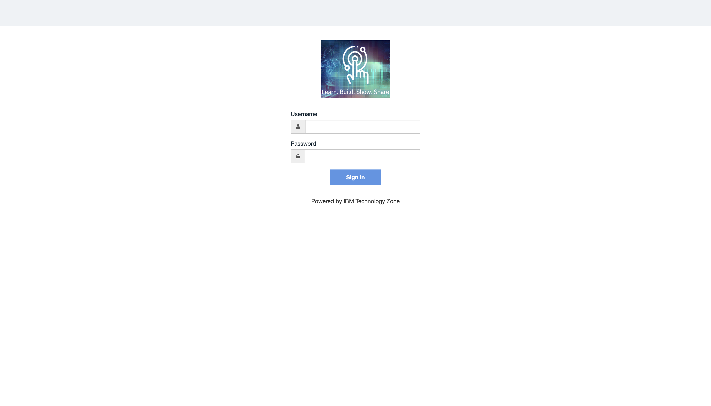

# Pre-Lab Check — Gear Up

**Duration:** 5 minutes  
**Goal:** Log in to watsonx Orchestrate and confirm your environment is ready before starting Lab 1.

---

## What You Need

The IBM team will hand you a credentials sheet at the start of the session. It contains:

| Item | Example |
|---|---|
| WXO Instance URL | `https://__________________.ibm.com` |
| Username | `student01` |
| Password | `__________________` |

> Keep this sheet open — you will need it again in Lab 1.

---

## Step 1 — Open watsonx Orchestrate

1. Open your browser (Chrome or Firefox recommended)
2. Navigate to the **WXO Instance URL** from your credentials sheet

> **[IMAGE 01 — Browser with WXO URL — screenshot pending]**

---

## Step 2 — Log In

You will see a login page powered by IBM Technology Zone.

*Login page — enter your Username and Password from the credentials sheet*

1. Enter your **Username** from the credentials sheet
2. Enter your **Password**
3. Click **Sign in**

---

## Step 3 — Verify You Are In

After logging in, you should land on the watsonx Orchestrate home page.

> **[IMAGE 03 — WXO home page after login — screenshot pending]**

Confirm you can see:
- [ ] The IBM watsonx Orchestrate logo at the top
- [ ] A left navigation panel with **Home**, **Agents**, **Tools**
- [ ] A **Build** or **Manage** option in the navigation

If you see this page, you are ready to start **Lab 1**.

---

## Image Reference

| # | File | Status |
|---|---|---|
| 01 | `images/01-wxo-url.png` | ⏳ pending |
| 02 | `images/02-wxo-login-page.png` | ✅ |
| 03 | `images/03-wxo-home-dashboard.png` | ⏳ pending |

---

## Troubleshooting

**Login page does not load**  
Check your internet connection and confirm the URL is correct — ask the IBM facilitator.

**Wrong password / account not found**  
Confirm you are using the credentials from the IBM sheet, not a personal account.

**Page loads but looks different from the screenshot**  
That is okay — the UI may differ slightly. As long as you see the navigation panel, you are in the right place.

---

## Next Step

Proceed to **Lab 1 — Building an IT Support Agent with ServiceNow and Gmail**.
